# Database

The Postgres schema behind Alghali Street (Supabase): every table, column, key, rule and status machine, and how money, alerts, timed jobs and files work at the database level. It describes the database **after migration `20261018100000_live_alerts`**, checked against `alghali-test` on 2026-10-16.

The source of truth is [`supabase/migrations/`](../supabase/migrations/). The RPC functions the apps call, with their parameters and error codes, are in [API.md](API.md); the reasons behind the design are in [DECISIONS.md](DECISIONS.md) (`D-…` numbers below). Update this file in the same change as any migration that adds or changes a table, column, constraint, status or setting.

## Contents

1. [At a glance](#at-a-glance)
2. [Conventions](#conventions)
3. [Tables by area](#tables-by-area)
4. [Enums](#enums)
5. [Tables](#tables)
   1. [Identity and platform](#identity-and-platform)
   2. [Catalogue and garage](#catalogue-and-garage)
   3. [Street, shops and addresses](#street-shops-and-addresses)
   4. [Inventory](#inventory)
   5. [Photo requests](#photo-requests)
   6. [Cart and orders](#cart-and-orders)
   7. [Payments and refunds](#payments-and-refunds)
   8. [Ledger and payouts](#ledger-and-payouts)
   9. [Chat](#chat)
   10. [Notifications](#notifications)
   11. [Technicians](#technicians)
   12. [Bookings (fittings)](#bookings-fittings)
   13. [Reviews and disputes](#reviews-and-disputes)
6. [Status machines](#status-machines)
7. [Money](#money)
8. [Settings](#settings)
9. [Alert codes](#alert-codes)
10. [Timed jobs](#timed-jobs)
11. [Storage](#storage)
12. [Realtime](#realtime)
13. [Functions](#functions)
14. [Extensions](#extensions)

## At a glance

| | |
|---|---|
| Tables (schema `public`) | 71, all with row level security on |
| Columns | 625 |
| Enums | 13 |
| Row level security policies | 80 on tables, 18 on storage |
| Triggers | 56 |
| Functions | 244: 15 callable by anyone, 102 more by signed-in users, the rest internal |
| Timed jobs (pg_cron) | 10 |
| Storage buckets | 8 |
| Migrations | 28 |

Users live in Supabase's `auth.users`; everything else in `public` refers to them by `uuid` (`buyer_id`, `user_id`, `created_by`, …). Deleting a user cascades to their own rows (profile, roles, garage, cart, addresses, devices, chat, requests, reviews) and sets `*_by` columns to null; a user with orders, bookings or refunds can't be deleted, because those foreign keys have no `on delete` rule.

## Conventions

- **Ids** are `uuid default gen_random_uuid()`. History tables (`*_events`, `audit_log`, `ledger_entries`, `listing_price_history`) use a `bigint` identity.
- **Times** are `timestamptz`, stored in UTC and shown in `Africa/Khartoum` (UTC+2, no daylight saving). Weekly hours (`availability_rules`, `shops.opening_hours`) are local wall-clock minutes after midnight; weekdays are 0 = Sunday … 6 = Saturday.
- **Money** is whole Sudanese pounds in `bigint` columns named `*_sdg`; never floats. Rates are basis points (`commission_bp`), rounded half up (D-014).
- **Bilingual text**: `*_ar` (required) and `*_en`.
- **Places**: clients write `lat` / `lng`; a generated `geography(Point, 4326)` column (`location`, `point`, `origin`, `home_point`) is computed from them for distance maths (PostGIS).
- **Phones** are E.164 (`+2499…`), normalised by `normalize_phone()`. **Bankak numbers** (transactions, accounts) are 6–20 digits.
- **Status columns** on sub-orders, payments and bookings are Postgres enums that change only along a transition table, through one `transition_*()` function that sets `app.actor`, writes the event row and applies side effects (D-082). Other statuses are `text` with a `check` list.
- **Retiring, not deleting**: catalogue and street rows have `is_active`; listings have `archived_at`; parts have `merged_into`.
- **Row level security** is on for every table (a test fails otherwise). Reads go through PostgREST under RLS; changes go through RPC functions, except a few owned tables the apps write directly (garage, addresses, cart, chat messages, technicians' hours and time off) and the catalogue tables admins edit. `tests/db/security.test.ts` lists every writable table and callable function on purpose.
- **Errors** are machine codes (`SHOP_NOT_ACTIVE`, `INVALID_TRANSITION`, …) with a SQLSTATE that sets the HTTP status (D-069); the list is in [API.md](API.md#conventions).

## Tables by area

**Identity and platform** — [`profiles`](#profiles), [`user_roles`](#user_roles), [`devices`](#devices), [`idempotency_keys`](#idempotency_keys), [`audit_log`](#audit_log), [`app_settings`](#app_settings), [`refs`](#refs)

**Catalogue and garage** — [`vehicle_makes`](#vehicle_makes), [`vehicle_models`](#vehicle_models), [`vehicle_variants`](#vehicle_variants), [`job_types`](#job_types), [`part_categories`](#part_categories), [`parts`](#parts), [`part_fitments`](#part_fitments), [`search_synonyms`](#search_synonyms), [`search_synonym_terms`](#search_synonym_terms), [`part_search_docs`](#part_search_docs), [`garage_vehicles`](#garage_vehicles)

**Street, shops and addresses** — [`markets`](#markets), [`streets`](#streets), [`zones`](#zones), [`shops`](#shops), [`shop_members`](#shop_members), [`shop_specialities`](#shop_specialities), [`addresses`](#addresses)

**Inventory** — [`listings`](#listings), [`listing_images`](#listing_images), [`listing_price_history`](#listing_price_history), [`import_jobs`](#import_jobs)

**Window tint** — [`shop_tint`](#shop_tint), [`shop_tint_prices`](#shop_tint_prices)

**Photo requests** — [`part_requests`](#part_requests), [`part_offers`](#part_offers)

**Cart and orders** — [`cart_items`](#cart_items), [`orders`](#orders), [`sub_orders`](#sub_orders), [`order_items`](#order_items), [`suborder_transitions`](#suborder_transitions), [`suborder_events`](#suborder_events), [`returns`](#returns)

**Payments and refunds** — [`payments`](#payments), [`payment_transitions`](#payment_transitions), [`payment_events`](#payment_events), [`refunds`](#refunds)

**Ledger and payouts** — [`ledger_accounts`](#ledger_accounts), [`ledger_journals`](#ledger_journals), [`ledger_entries`](#ledger_entries), [`payout_runs`](#payout_runs), [`payouts`](#payouts), [`payout_run_balances`](#payout_run_balances), [`payout_run_tech_balances`](#payout_run_tech_balances)

**Chat** — [`conversations`](#conversations), [`messages`](#messages)

**Notifications** — [`notification_codes`](#notification_codes), [`notification_templates`](#notification_templates), [`notifications`](#notifications), [`notification_deliveries`](#notification_deliveries)

**Technicians** — [`technicians`](#technicians), [`technician_job_types`](#technician_job_types), [`technician_makes`](#technician_makes), [`availability_rules`](#availability_rules), [`time_off`](#time_off)

**Bookings (fittings)** — [`bookings`](#bookings), [`booking_transitions`](#booking_transitions), [`booking_events`](#booking_events), [`booking_items`](#booking_items), [`booking_offers`](#booking_offers), [`booking_codes`](#booking_codes), [`booking_photos`](#booking_photos), [`tech_locations`](#tech_locations)

**Reviews and disputes** — [`reviews`](#reviews), [`disputes`](#disputes), [`dispute_messages`](#dispute_messages)

## Enums

| Enum | Values | Used by | Meaning |
|---|---|---|---|
| `app_role` | `BUYER`, `SHOP_OWNER`, `SHOP_STAFF`, `TECHNICIAN`, `ADMIN` | `user_roles.role` | A user's roles (`user_roles`). Everyone has `BUYER`. |
| `booking_place` | `BAY`, `CUSTOMER_LOCATION` | `bookings.place` | Where a fitting happens. |
| `booking_status` | `HELD`, `AWAITING_PAYMENT`, `PENDING_TECH_ACCEPT`, `ACCEPTED`, `EN_ROUTE`, `IN_PROGRESS`, `COMPLETED`, `NEEDS_RESCHEDULE`, `EXPIRED`, `CANCELLED_BY_BUYER`, `CANCELLED_BY_TECH`, `CANCELLED_BY_ADMIN`, `PART_DOES_NOT_FIT` | `booking_events.from_status`, `booking_events.to_status`, `booking_transitions.from_status`, `booking_transitions.to_status`, `bookings.status` | See [Booking status](#booking-status). |
| `fulfilment_type` | `PICKUP`, `DELIVERY`, `TO_TECHNICIAN` | `sub_orders.fulfilment` | How a sub-order reaches the buyer. `TO_TECHNICIAN`: the parts of a fitting, collected by the technician. |
| `listing_condition` | `NEW_OEM`, `NEW_AFTERMARKET`, `USED` | `listings.condition`, `order_items.condition`, `part_offers.condition` | New original, new aftermarket, or used. |
| `notify_channel` | `PUSH`, `SMS`, `WHATSAPP` | `notification_deliveries.channel` | Delivery channel. Only `PUSH` is sent at launch; `SMS` is recorded as a stub (D-061). |
| `offer_status` | `OFFERED`, `ACCEPTED`, `DECLINED`, `TIMED_OUT`, `WITHDRAWN` | `booking_offers.status` | A job offer to one technician (`booking_offers`). |
| `partner_status` | `PENDING`, `APPROVED`, `REJECTED`, `SUSPENDED` | `shops.status`, `technicians.status` | Review state of a shop or technician. |
| `payment_method` | `BANKAK`, `CASH` | `bookings.payment_method`, `orders.payment_method`, `payments.method` | Bankak transfer or cash. |
| `payment_purpose` | `ORDER`, `BOOKING_DEPOSIT` | `payments.purpose` | What a payment is for. |
| `payment_status` | `AWAITING_TRANSFER`, `RECEIPT_SUBMITTED`, `CONFIRMED`, `REJECTED`, `DUE`, `COLLECTED`, `EXPIRED`, `CANCELLED` | `payment_events.from_status`, `payment_events.to_status`, `payment_transitions.from_status`, `payment_transitions.to_status`, `payments.status` | See [Payment status](#payment-status). |
| `suborder_status` | `PENDING_PAYMENT`, `PAYMENT_REVIEW`, `CONFIRMED`, `READY`, `PICKED_UP`, `OUT_FOR_DELIVERY`, `DELIVERED`, `HANDED_TO_TECHNICIAN`, `COMPLETED`, `CANCELLED`, `REJECTED_BY_SHOP`, `RETURN_REQUESTED`, `RETURNED` | `sub_orders.status`, `suborder_events.from_status`, `suborder_events.to_status`, `suborder_transitions.from_status`, `suborder_transitions.to_status` | See [Sub-order status](#sub-order-status). |
| `work_mode` | `BAY`, `MOBILE`, `BOTH` | `availability_rules.modes`, `technicians.work_mode` | Where a technician works: a bay on the street, mobile, or both. Also the kind of job an availability rule covers. |

## Tables

Each table lists its columns (🔑 = primary key; **Null** = "yes" when the column may be null), then its keys, checks spanning several columns, indexes and triggers. **Access** says who reads and writes it under RLS; "directly" means through PostgREST, otherwise only through the named RPCs.

### Identity and platform

Who people are, what they may do, their phones, and the plumbing every RPC shares (settings, idempotency, references, the audit trail).

#### `profiles`

One row per sign-up, created by the `on_auth_user_created` trigger on `auth.users` (`handle_new_user()`), which also grants `BUYER`. `email` follows `auth.users` through `handle_user_email_change()`. Changed only through `update_profile()` and `set_refund_account()`.

**Access:** Self and admins read. No direct writes.

| Column | Type | Null | Default | Notes |
|---|---|---|---|---|
| `id` 🔑 | uuid |  |  | Same as `auth.users.id`. → `auth.users.id` (cascade) |
| `email` | text | yes |  | Copied from `auth.users` |
| `phone` | text | yes |  | E.164 (`+2499…`); any Sudanese format is accepted on input. Needed to check out. check: `(phone IS NULL) OR (phone ~ '^\+[1-9][0-9]{7,14}$')` |
| `phone_verified_at` | timestamptz | yes |  | Stays null until phone OTP exists (D-030, D-059) |
| `display_name` | text |  | `''` | check: `≤ 80 chars` |
| `locale` | text |  | `'ar'` | check: `ar, en` |
| `data_saver` | boolean |  | `true` | Smaller images on mobile data |
| `created_at` | timestamptz |  | `now()` |  |
| `updated_at` | timestamptz |  | `now()` | Set by trigger on update |
| `refund_account` | text | yes |  | The buyer's Bankak account for refunds. check: `matches '^[0-9]{6,20}$'` |

- Trigger `profiles_updated_at`: before update → `tg_set_updated_at()`

#### `user_roles`

The roles a user holds. RLS and every `require_*()` helper read this table on each call (no JWT claims hook, D-065), so revoking a role takes effect at once. Shop roles are granted when a shop is approved; `TECHNICIAN` when a technician is approved.

**Access:** Self and admins read. Changed by `admin_grant_role` / `admin_revoke_role` and the approval RPCs.

| Column | Type | Null | Default | Notes |
|---|---|---|---|---|
| `user_id` 🔑 | uuid |  |  | → `auth.users.id` (cascade) |
| `role` 🔑 | app_role |  |  |  |
| `granted_by` | uuid | yes |  | Admin who granted it; null for automatic grants. → `auth.users.id` (set null) |
| `granted_at` | timestamptz |  | `now()` |  |

- Primary key (`user_id`, `role`)

#### `devices`

Phones registered for push. One row per FCM token; a token that signs in to another account moves to it. The dispatcher sends a push to every device of the user for the app the alert is for.

**Access:** Self reads. `register_device` / `unregister_device`.

| Column | Type | Null | Default | Notes |
|---|---|---|---|---|
| `id` 🔑 | uuid |  | `gen_random_uuid()` |  |
| `user_id` | uuid |  |  | → `auth.users.id` (cascade) |
| `app` | text |  |  | Which app registered the token. check: `buyer, partner, admin` |
| `platform` | text |  |  | check: `android, ios, web` |
| `fcm_token` | text |  |  | Firebase Cloud Messaging token. check: `length 10–4096` |
| `app_build` | integer | yes |  | Build number, for the update banner. check: `> 0` |
| `locale` | text | yes |  | Language the alerts are worded in for this phone. check: `ar, en` |
| `last_seen_at` | timestamptz |  | `now()` |  |
| `created_at` | timestamptz |  | `now()` |  |

- Unique (`fcm_token`)
- Index `devices_user_idx` on (user_id)

#### `idempotency_keys`

Saved results of creating RPCs (`p_idem`), so the apps' offline outbox can replay a call safely. Written by `idem_begin()` / `idem_finish()`; kept 7 days (cron `idempotency-keys-cleanup`).

**Access:** No client access.

| Column | Type | Null | Default | Notes |
|---|---|---|---|---|
| `user_id` 🔑 | uuid |  |  | → `auth.users.id` (cascade) |
| `key` 🔑 | uuid |  |  | The `p_idem` the app sent |
| `op` | text |  |  | Function name; a key reused for another function is `IDEMPOTENCY_KEY_REUSED` |
| `response` | jsonb |  |  | The first call's result, returned on replay |
| `created_at` | timestamptz |  | `now()` |  |

- Primary key (`user_id`, `key`)

#### `audit_log`

Every admin action (`audit()`) and every admin edit of catalogue and street tables (`tg_audit_row`, which skips rows written without a signed-in user: migrations, seed, cron). `data` holds the row, or `{old, new}` for updates.

**Access:** Admins read.

| Column | Type | Null | Default | Notes |
|---|---|---|---|---|
| `id` 🔑 | bigint |  | `identity` | Identity |
| `actor_id` | uuid | yes |  | → `auth.users.id` (set null) |
| `action` | text |  |  | e.g. `SET_SHOP_STATUS`, `INSERT`, `UPDATE`, `DELETE` |
| `entity` | text |  |  | Table or kind of thing changed |
| `entity_id` | text | yes |  |  |
| `data` | jsonb | yes |  |  |
| `created_at` | timestamptz |  | `now()` |  |

- Index `audit_log_entity_idx` on (entity, entity_id)

#### `app_settings`

Admin-editable configuration. Read with `setting(key)` / `setting_int(key)`; apps read the `is_public` keys through `public_settings()`. Every key has a shape check in `validate_setting()`. See [Settings](#settings) for the keys.

**Access:** No direct access; `admin_settings()` / `admin_update_setting()`.

| Column | Type | Null | Default | Notes |
|---|---|---|---|---|
| `key` 🔑 | text |  |  | check: `matches '^[a-z][a-z0-9_]*$'` |
| `value` | jsonb |  |  |  |
| `description` | text | yes |  |  |
| `is_public` | boolean |  | `false` | Readable by the apps through `public_settings()` |
| `updated_by` | uuid | yes |  | → `auth.users.id` (set null) |
| `updated_at` | timestamptz |  | `now()` | Set by trigger on update |

#### `refs`

Every reference number a buyer may type into a Bankak transfer note, shared by orders and bookings so the two never collide: 7 random digits (no leading zero) plus a Luhn check digit (D-016). Issued by `new_ref(kind)`.

**Access:** No client access.

| Column | Type | Null | Default | Notes |
|---|---|---|---|---|
| `ref` 🔑 | text |  |  | check: `matches '^[1-9][0-9]{7}$'` |
| `kind` | text |  |  | `ORDER` or `BOOKING`. check: `ORDER, BOOKING` |
| `created_at` | timestamptz |  | `now()` |  |

### Catalogue and garage

Cars, parts and what fits what. Admins edit these tables directly under RLS (D-068) and every change is audited. The starter catalogue is a migration and exists in every environment (D-062, D-071). Rows are retired with `is_active = false`, never deleted, so the apps' offline catalogue (`catalogue_snapshot(p_since)`) can see them go.

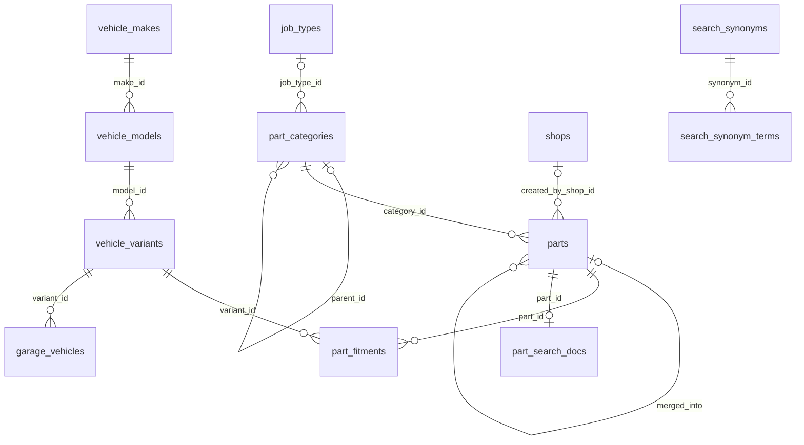

#### `vehicle_makes`

Car makes (Toyota, Hyundai, ...).

**Access:** Anyone reads active rows; admins read all and write.

| Column | Type | Null | Default | Notes |
|---|---|---|---|---|
| `id` 🔑 | uuid |  | `gen_random_uuid()` |  |
| `slug` | text |  |  | URL-safe name. check: `matches '^[a-z0-9]+(-[a-z0-9]+)*$'` |
| `name_ar` | text |  |  | Arabic. check: `not blank` |
| `name_en` | text |  |  | English. check: `not blank` |
| `sort` | integer |  | `0` | Display order |
| `is_active` | boolean |  | `true` | False = retired (kept for the offline catalogue) |
| `updated_at` | timestamptz |  | `now()` | Set by trigger on update |

- Unique (`slug`)
- Trigger `vehicle_makes_audit`: after insert or delete or update → `tg_audit_row()`
- Trigger `vehicle_makes_updated_at`: before update → `tg_set_updated_at()`

#### `vehicle_models`

Models of a make.

**Access:** As makes.

| Column | Type | Null | Default | Notes |
|---|---|---|---|---|
| `id` 🔑 | uuid |  | `gen_random_uuid()` |  |
| `make_id` | uuid |  |  | → `vehicle_makes.id` |
| `slug` | text |  |  | URL-safe name. check: `matches '^[a-z0-9]+(-[a-z0-9]+)*$'` |
| `name_ar` | text |  |  | Arabic. check: `not blank` |
| `name_en` | text |  |  | English. check: `not blank` |
| `sort` | integer |  | `0` | Display order |
| `is_active` | boolean |  | `true` | False = retired (kept for the offline catalogue) |
| `updated_at` | timestamptz |  | `now()` | Set by trigger on update |

- Unique (`make_id`, `slug`)
- Index `vehicle_models_make_idx` on (make_id)
- Trigger `vehicle_models_audit`: after insert or delete or update → `tg_audit_row()`
- Trigger `vehicle_models_updated_at`: before update → `tg_set_updated_at()`

#### `vehicle_variants`

One generation and engine of a model, with its year range. This is what a buyer's car and a part's fitment point at.

**Access:** As makes.

| Column | Type | Null | Default | Notes |
|---|---|---|---|---|
| `id` 🔑 | uuid |  | `gen_random_uuid()` |  |
| `model_id` | uuid |  |  | → `vehicle_models.id` |
| `slug` | text |  |  | Unique within the model. check: `matches '^[a-z0-9]+(-[a-z0-9]+)*$'` |
| `year_from` | integer |  |  | check: `1950–2100` |
| `year_to` | integer |  |  |  |
| `engine_ar` | text |  | `''` | Arabic |
| `engine_en` | text |  | `''` | English |
| `engine_code` | text | yes |  | Maker's engine code, e.g. `2AZ-FE` |
| `fuel` | text | yes |  | check: `PETROL, DIESEL, HYBRID, ELECTRIC` |
| `sort` | integer |  | `0` | Display order |
| `is_active` | boolean |  | `true` | False = retired (kept for the offline catalogue) |
| `updated_at` | timestamptz |  | `now()` | Set by trigger on update |

- Unique (`model_id`, `slug`)
- Check: `(year_to >= year_from) AND (year_to <= 2100)`
- Index `vehicle_variants_model_idx` on (model_id)
- Trigger `vehicle_variants_audit`: after insert or delete or update → `tg_audit_row()`
- Trigger `vehicle_variants_updated_at`: before update → `tg_set_updated_at()`

#### `job_types`

Kinds of fitting job (LIGHTING, BRAKES, ...). A technician sets a labour price per job type; a part category says which job type fits it.

**Access:** Anyone reads; admins write.

| Column | Type | Null | Default | Notes |
|---|---|---|---|---|
| `id` 🔑 | uuid |  | `gen_random_uuid()` |  |
| `code` | text |  |  | Stable code the apps key on. check: `matches '^[A-Z][A-Z_]*$'` |
| `name_ar` | text |  |  | Arabic |
| `name_en` | text |  |  | English |
| `sort` | integer |  | `0` | Display order |
| `updated_at` | timestamptz |  | `now()` | Set by trigger on update |

- Unique (`code`)
- Trigger `job_types_audit`: after insert or delete or update → `tg_audit_row()`
- Trigger `job_types_updated_at`: before update → `tg_set_updated_at()`

#### `part_categories`

The category tree (`parent_id`). A category can carry the job type and standard minutes used when a part in it is fitted.

**Access:** Anyone reads active rows; admins read all and write.

| Column | Type | Null | Default | Notes |
|---|---|---|---|---|
| `id` 🔑 | uuid |  | `gen_random_uuid()` |  |
| `parent_id` | uuid | yes |  | Null for top-level categories. → `part_categories.id` |
| `slug` | text |  |  | URL-safe name. check: `matches '^[a-z0-9]+(-[a-z0-9]+)*$'` |
| `name_ar` | text |  |  | Arabic. check: `not blank` |
| `name_en` | text |  |  | English. check: `not blank` |
| `icon` | text |  | `'accessories'` | Icon name the apps draw. check: `lighting, brakes, oil, battery, electrical, ac, suspension, tyres, engine, transmission, body, accessories, tint`. `tint` marks window tint (slug `window-tint`, job type `TINT`, D-149): the buyer app opens the tint screen instead of a search |
| `job_type_id` | uuid | yes |  | Job type for fitting parts of this category. → `job_types.id` |
| `std_job_minutes` | integer | yes |  | Standard fitting time. check: `5–600` |
| `sort` | integer |  | `0` | Display order |
| `is_active` | boolean |  | `true` | False = retired (kept for the offline catalogue) |
| `updated_at` | timestamptz |  | `now()` | Set by trigger on update |

- Unique (`slug`)
- Check: `parent_id IS DISTINCT FROM id`
- Index `part_categories_parent_idx` on (parent_id)
- Trigger `part_categories_audit`: after insert or delete or update → `tg_audit_row()`
- Trigger `part_categories_search_doc`: after update of name_ar, name_en, parent_id → `tg_categories_search_doc()`
- Trigger `part_categories_updated_at`: before update → `tg_set_updated_at()`

#### `parts`

Catalogue parts. Shops may type in their own (`created_by_shop_id`, `is_verified = false`, D-067); admins merge duplicates into a catalogue part with `admin_merge_parts()` (`merged_into`).

**Access:** Anyone reads active, unmerged parts; admins read all and write. Shops write through `shop_upsert_listing(p_new_part)`.

| Column | Type | Null | Default | Notes |
|---|---|---|---|---|
| `id` 🔑 | uuid |  | `gen_random_uuid()` |  |
| `category_id` | uuid |  |  | → `part_categories.id` |
| `name_ar` | text |  |  | Arabic. check: `trimmed length 2–120` |
| `name_en` | text |  | `''` | English. check: `≤ 120 chars` |
| `desc_ar` | text | yes |  | Arabic. check: `≤ 1000 chars` |
| `desc_en` | text | yes |  | English. check: `≤ 1000 chars` |
| `oem_numbers` | text[] |  | `'{}'` | Manufacturer part numbers, searchable. check: `≤ 20 items` |
| `keywords` | text[] |  | `'{}'` | Extra search words. check: `≤ 30 items` |
| `installable` | boolean |  | `true` | Can be booked for fitting |
| `std_job_minutes` | integer | yes |  | Overrides the category's. check: `5–600` |
| `created_by_shop_id` | uuid | yes |  | Set for parts a shop typed in. → `shops.id` (set null) |
| `is_verified` | boolean |  | `true` | False until an admin checks a shop's part |
| `merged_into` | uuid | yes |  | The catalogue part this duplicate was merged into. → `parts.id` |
| `is_active` | boolean |  | `true` | False = retired (kept for the offline catalogue) |
| `created_at` | timestamptz |  | `now()` |  |
| `updated_at` | timestamptz |  | `now()` | Set by trigger on update |

- Check: `merged_into IS DISTINCT FROM id`
- Index `parts_category_idx` on (category_id)
- Index `parts_shop_idx` on (created_by_shop_id) where `created_by_shop_id IS NOT NULL`
- Trigger `parts_audit`: after insert or delete or update → `tg_audit_row()`
- Trigger `parts_search_doc`: after insert or update of name_ar, name_en, keywords, oem_numbers, category_id → `tg_parts_search_doc()`
- Trigger `parts_updated_at`: before update → `tg_set_updated_at()`

#### `part_fitments`

Which car variants a part fits. A part with no rows here shows as "check fitment"; a part with rows that leave out the buyer's car is hidden from that buyer's search.

**Access:** Anyone reads; admins write.

| Column | Type | Null | Default | Notes |
|---|---|---|---|---|
| `part_id` 🔑 | uuid |  |  | → `parts.id` (cascade) |
| `variant_id` 🔑 | uuid |  |  | → `vehicle_variants.id` (cascade) |
| `note_ar` | text | yes |  | Arabic. check: `≤ 200 chars` |
| `note_en` | text | yes |  | English. check: `≤ 200 chars` |

- Primary key (`part_id`, `variant_id`)
- Index `part_fitments_variant_idx` on (variant_id)
- Trigger `part_fitments_audit`: after insert or delete or update → `tg_audit_row()`

#### `search_synonyms`

Groups of words that mean the same in search (colloquial and formal Arabic, English). One row is one group.

**Access:** Anyone reads; admins write.

| Column | Type | Null | Default | Notes |
|---|---|---|---|---|
| `id` 🔑 | uuid |  | `gen_random_uuid()` |  |
| `terms` | text[] |  |  | The words of the group, as typed. check: `2–40 items` |
| `updated_by` | uuid | yes |  | → `auth.users.id` (set null) |
| `updated_at` | timestamptz |  | `now()` | Set by trigger on update |

- Trigger `search_synonyms_audit`: after insert or delete or update → `tg_audit_row()`
- Trigger `search_synonyms_terms`: after insert or update of terms → `tg_synonym_terms()`
- Trigger `search_synonyms_updated_at`: before update → `tg_set_updated_at()`

#### `search_synonym_terms`

The normalised words of each synonym group, kept by the `search_synonyms_terms` trigger, used by `search_expand()` to widen a query.

**Access:** No client access.

| Column | Type | Null | Default | Notes |
|---|---|---|---|---|
| `synonym_id` 🔑 | uuid |  |  | → `search_synonyms.id` (cascade) |
| `term` 🔑 | text |  |  |  |

- Primary key (`synonym_id`, `term`)
- Index `search_synonym_terms_term_idx` on (term text_pattern_ops)

#### `part_search_docs`

One search document per part (names, keywords, OEM numbers, category names, brands of its listings), normalised with `ar_normalize()`. Kept current by triggers on `parts`, `part_categories` and `listings` through `refresh_part_search_doc()`. `search_parts()` reads it: full text first, trigram matching as a fallback for typos (D-066).

**Access:** No client access.

| Column | Type | Null | Default | Notes |
|---|---|---|---|---|
| `part_id` 🔑 | uuid |  |  | → `parts.id` (cascade) |
| `terms` | text[] |  |  | Normalised words |
| `doc` | text |  |  | Normalised text, for trigram matching |
| `tsv` | tsvector |  |  | Full-text vector |
| `updated_at` | timestamptz |  | `now()` | Set by trigger on update |

- Index `part_search_docs_trgm_idx` on (doc gin_trgm_ops) (gin)
- Index `part_search_docs_tsv_idx` on (tsv) (gin)

#### `garage_vehicles`

A buyer's cars. The trigger cleans the VIN, plate and nickname, caps the garage at 10 cars (`GARAGE_FULL`) and keeps exactly one default (the first car becomes default; deleting the default promotes the newest).

**Access:** Self reads and writes directly.

| Column | Type | Null | Default | Notes |
|---|---|---|---|---|
| `id` 🔑 | uuid |  | `gen_random_uuid()` |  |
| `user_id` | uuid |  | `auth.uid()` | → `auth.users.id` (cascade) |
| `variant_id` | uuid |  |  | → `vehicle_variants.id` |
| `nickname` | text | yes |  | check: `≤ 40 chars` |
| `vin` | text | yes |  | 17 characters, upper-cased; optional. check: `matches '^[A-HJ-NPR-Z0-9]{17}$'` |
| `plate` | text | yes |  | check: `≤ 20 chars` |
| `is_default` | boolean |  | `false` | Exactly one per user (trigger) |
| `created_at` | timestamptz |  | `now()` |  |

- Unique index `garage_vehicles_one_default` on (user_id) where `is_default`
- Index `garage_vehicles_user_idx` on (user_id)
- Trigger `garage_vehicles_after_delete`: after delete → `tg_garage_after_delete()`
- Trigger `garage_vehicles_before`: before insert or update → `tg_garage_before()`

### Street, shops and addresses

The market is a street divided into numbered zones; shops sit in a zone at a position along the street. Clients write plain `lat` / `lng`; the `geography` columns are generated from them.

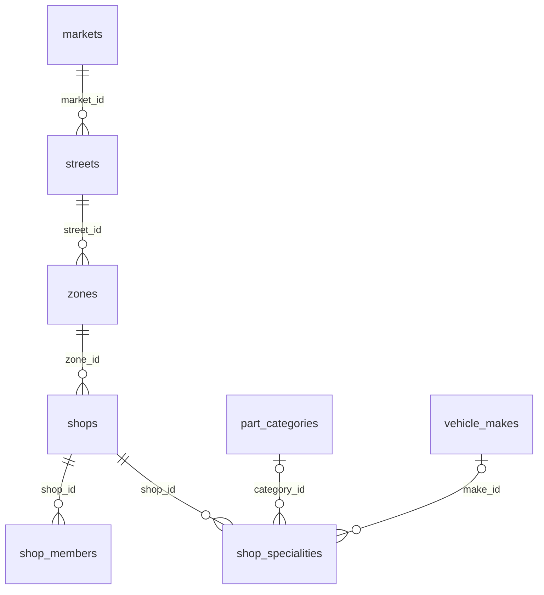

#### `markets`

A market (one at launch). `tz` is the time zone used for local times.

**Access:** Anyone reads active rows; admins write.

| Column | Type | Null | Default | Notes |
|---|---|---|---|---|
| `id` 🔑 | uuid |  | `gen_random_uuid()` |  |
| `slug` | text |  |  | URL-safe name. check: `matches '^[a-z0-9]+(-[a-z0-9]+)*$'` |
| `name_ar` | text |  |  | Arabic |
| `name_en` | text |  |  | English |
| `city_ar` | text |  | `''` | Arabic |
| `city_en` | text |  | `''` | English |
| `tz` | text |  | `'Africa/Khartoum'` | Time zone for local times |
| `is_active` | boolean |  | `true` | False = retired (kept for the offline catalogue) |
| `updated_at` | timestamptz |  | `now()` | Set by trigger on update |

- Unique (`slug`)
- Trigger `markets_audit`: after insert or delete or update → `tg_audit_row()`
- Trigger `markets_updated_at`: before update → `tg_set_updated_at()`

#### `streets`

A street of a market. `origin` is where travel and delivery distances are measured from; the owner sets it before launch (D-077).

**Access:** As markets.

| Column | Type | Null | Default | Notes |
|---|---|---|---|---|
| `id` 🔑 | uuid |  | `gen_random_uuid()` |  |
| `market_id` | uuid |  |  | → `markets.id` |
| `slug` | text |  |  | URL-safe name. check: `matches '^[a-z0-9]+(-[a-z0-9]+)*$'` |
| `name_ar` | text |  |  | Arabic |
| `name_en` | text |  |  | English |
| `length_m` | integer |  | `1000` | Length in metres. check: `> 0` |
| `origin_lat` | float8 | yes |  | Start of the street; distances are measured from here. check: `-90–90` |
| `origin_lng` | float8 | yes |  | check: `-180–180` |
| `origin` | geography(Point) | yes |  | **generated**. Generated from `origin_lat` / `origin_lng` |
| `is_active` | boolean |  | `true` | False = retired (kept for the offline catalogue) |
| `updated_at` | timestamptz |  | `now()` | Set by trigger on update |

- Unique (`market_id`, `slug`)
- Trigger `streets_audit`: after insert or delete or update → `tg_audit_row()`
- Trigger `streets_updated_at`: before update → `tg_set_updated_at()`

#### `zones`

Numbered stretches of a street, in metres from its start.

**Access:** As markets.

| Column | Type | Null | Default | Notes |
|---|---|---|---|---|
| `id` 🔑 | uuid |  | `gen_random_uuid()` |  |
| `street_id` | uuid |  |  | → `streets.id` |
| `seq` | integer |  |  | Zone number along the street. check: `> 0` |
| `name_ar` | text |  |  | Arabic |
| `name_en` | text |  |  | English |
| `from_m` | integer |  |  | Start, metres from the street origin. check: `>= 0` |
| `to_m` | integer |  |  | End, metres from the street origin |
| `is_active` | boolean |  | `true` | False = retired (kept for the offline catalogue) |
| `updated_at` | timestamptz |  | `now()` | Set by trigger on update |

- Unique (`street_id`, `seq`)
- Check: `to_m > from_m`
- Trigger `zones_audit`: after insert or delete or update → `tg_audit_row()`
- Trigger `zones_updated_at`: before update → `tg_set_updated_at()`

#### `shops`

A shop. It starts `PENDING` (`apply_as_shop`) and an admin approves, rejects or suspends it (`admin_set_shop_status`). Shops may prepare stock while `PENDING`. `rating_avg` / `rating_count` are kept by the `reviews_rollup` trigger. `closed_until` is "closed today" (D-119).

**Access:** Anyone reads approved shops; members and admins read their own / all. Changed through `shop_update_profile`, `shop_set_closed` and admin RPCs.

| Column | Type | Null | Default | Notes |
|---|---|---|---|---|
| `id` 🔑 | uuid |  | `gen_random_uuid()` |  |
| `zone_id` | uuid |  |  | → `zones.id` |
| `name_ar` | text |  |  | Arabic. check: `trimmed length 2–80` |
| `name_en` | text |  | `''` | English. check: `≤ 80 chars` |
| `plot_no` | text | yes |  | Plot number on the street. check: `≤ 20 chars` |
| `side` | text | yes |  | Side of the street. check: `A, B` |
| `landmark_ar` | text | yes |  | Arabic. check: `≤ 200 chars` |
| `landmark_en` | text | yes |  | English. check: `≤ 200 chars` |
| `about_ar` | text | yes |  | Arabic. check: `≤ 500 chars` |
| `about_en` | text | yes |  | English. check: `≤ 500 chars` |
| `lat` | float8 | yes |  | check: `-90–90` |
| `lng` | float8 | yes |  | check: `-180–180` |
| `location` | geography(Point) | yes |  | **generated**. Generated from `lat` / `lng` (the map pin, D-145) |
| `pos_m` | integer | yes |  | Position along the street in metres; orders pickup stops. Set mid-zone on approval if empty. check: `>= 0` |
| `storefront_key` | text | yes |  | Storefront photo in `media-public`. check: `≤ 300 chars` |
| `phone` | text | yes |  | check: `matches '^\+[1-9][0-9]{7,14}$'` |
| `whatsapp` | text | yes |  | check: `matches '^\+[1-9][0-9]{7,14}$'` |
| `opening_hours` | jsonb |  | `'{}'` | `{"0": [[480, 1200]], …}`: weekday (0 = Sunday) → windows in minutes after midnight, Khartoum time; a missing day is closed. check: `valid_opening_hours(opening_hours)` |
| `status` | partner_status |  | `'PENDING'` |  |
| `status_reason` | text | yes |  | Why it was rejected or suspended. check: `≤ 500 chars` |
| `verified` | boolean |  | `false` | The "verified" badge (`admin_verify_shop`) |
| `rating_avg` | numeric(3,2) |  | `0` | Average of visible reviews (trigger) |
| `rating_count` | integer |  | `0` | Number of visible reviews (trigger) |
| `created_by` | uuid | yes |  | → `auth.users.id` (set null) |
| `approved_at` | timestamptz | yes |  |  |
| `created_at` | timestamptz |  | `now()` |  |
| `updated_at` | timestamptz |  | `now()` | Set by trigger on update |
| `closed_until` | timestamptz | yes |  | "Closed today" until this time (≤ 7 days ahead) |

- Index `shops_status_idx` on (status)
- Index `shops_zone_idx` on (zone_id)
- Trigger `shops_updated_at`: before update → `tg_set_updated_at()`

#### `shop_members`

Who works at a shop: one `OWNER` and staff. A user may belong to several shops (3 owned at most).

**Access:** Members of the same shop and admins read. `shop_add_staff` / `shop_remove_staff`.

| Column | Type | Null | Default | Notes |
|---|---|---|---|---|
| `shop_id` 🔑 | uuid |  |  | → `shops.id` (cascade) |
| `user_id` 🔑 | uuid |  |  | → `auth.users.id` (cascade) |
| `role` | text |  |  | check: `OWNER, STAFF` |
| `added_by` | uuid | yes |  | The owner who added them. → `auth.users.id` (set null) |
| `created_at` | timestamptz |  | `now()` |  |

- Primary key (`shop_id`, `user_id`)
- Index `shop_members_user_idx` on (user_id)

#### `shop_specialities`

Categories and makes a shop deals in: exactly one of the two per row. Used to send photo requests to the right shops.

**Access:** Anyone reads. Set through `apply_as_shop` / `shop_update_profile`.

| Column | Type | Null | Default | Notes |
|---|---|---|---|---|
| `shop_id` | uuid |  |  | → `shops.id` (cascade) |
| `category_id` | uuid | yes |  | → `part_categories.id` |
| `make_id` | uuid | yes |  | → `vehicle_makes.id` |

- Unique (`shop_id`, `category_id`, `make_id`), nulls counted as equal
- Check: `num_nonnulls(category_id, make_id) = 1`

#### `addresses`

A buyer's saved places for delivery and fittings at home. The trigger caps the book at 10 (`ADDRESS_BOOK_FULL`) and keeps one default.

**Access:** Self reads and writes directly.

| Column | Type | Null | Default | Notes |
|---|---|---|---|---|
| `id` 🔑 | uuid |  | `gen_random_uuid()` |  |
| `user_id` | uuid |  | `auth.uid()` | → `auth.users.id` (cascade) |
| `label` | text |  |  | e.g. "Home". check: `trimmed length 1–40` |
| `description_ar` | text | yes |  | Written directions. check: `≤ 300 chars` |
| `lat` | float8 |  |  | check: `-90–90` |
| `lng` | float8 |  |  | check: `-180–180` |
| `location` | geography(Point) | yes |  | **generated**. Generated from `lat` / `lng` |
| `is_default` | boolean |  | `false` | Exactly one per user (trigger) |
| `created_at` | timestamptz |  | `now()` |  |
| `updated_at` | timestamptz |  | `now()` | Set by trigger on update |

- Unique index `addresses_one_default` on (user_id) where `is_default`
- Index `addresses_user_idx` on (user_id)
- Trigger `addresses_before`: before insert or update → `tg_addresses_before()`
- Trigger `addresses_updated_at`: before update → `tg_set_updated_at()`

### Inventory

What each shop sells. A listing is one shop's offer of one part in one condition.

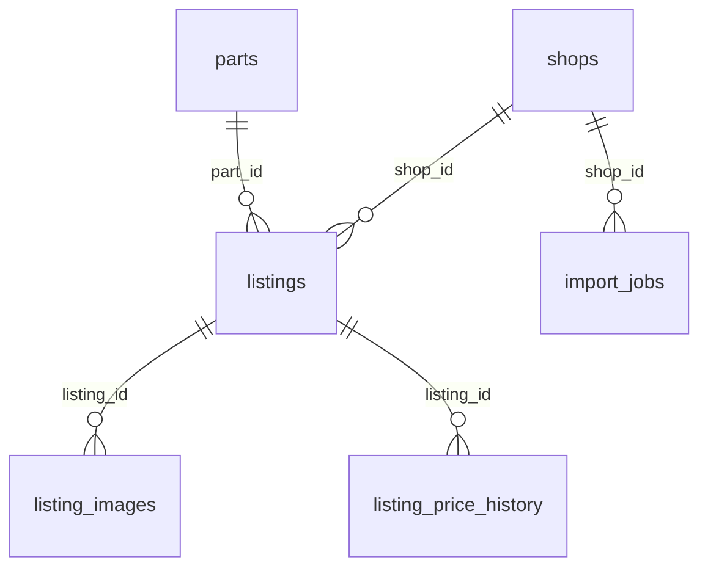

#### `listings`

A shop's stock line: price (or "price on request"), stock, condition, warranty. `reserved_qty` is stock held by unpaid or unfulfilled orders and can never exceed `stock_qty`. Every real change raises `version` (offline edits send the version they saw; a mismatch is `VERSION_CONFLICT`). A price cut keeps the old price in `was_sdg`, shown as a deal for 14 days, and every price change is written to `listing_price_history`. Archiving (`archived_at`) hides a listing for good.

**Access:** Anyone reads active listings of approved shops; members read their shop's all. Written through `shop_upsert_listing`, `shop_bulk_update`, `shop_archive_listing`, `shop_import_rows`.

| Column | Type | Null | Default | Notes |
|---|---|---|---|---|
| `id` 🔑 | uuid |  | `gen_random_uuid()` |  |
| `shop_id` | uuid |  |  | → `shops.id` (cascade) |
| `part_id` | uuid |  |  | → `parts.id` |
| `sku` | text | yes |  | The shop's own code, for imports; unique per shop. check: `length 1–40` |
| `condition` | listing_condition |  |  |  |
| `price_sdg` | bigint | yes |  | Null only with `price_on_request`. check: `1–1000000000` |
| `price_on_request` | boolean |  | `false` |  |
| `was_sdg` | bigint | yes |  | The higher price before the last cut, shown as a deal |
| `price_changed_at` | timestamptz | yes |  | Last price change |
| `stock_qty` | integer |  | `0` | On the shelf, including reserved. check: `0–100000` |
| `reserved_qty` | integer |  | `0` | Held by orders not yet handed over. check: `>= 0` |
| `warranty_days` | integer |  | `0` | check: `0–1825` |
| `brand` | text | yes |  | Maker of this item; searchable. check: `≤ 40 chars` |
| `note_ar` | text | yes |  | Arabic. check: `≤ 300 chars` |
| `is_active` | boolean |  | `true` | False = retired (kept for the offline catalogue) |
| `archived_at` | timestamptz | yes |  | Hidden for good |
| `version` | integer |  | `1` | Raised by the trigger on every real change (optimistic concurrency for offline edits) |
| `created_by` | uuid | yes |  | → `auth.users.id` (set null) |
| `created_at` | timestamptz |  | `now()` |  |
| `updated_at` | timestamptz |  | `now()` | Set by trigger on update |

- Unique (`shop_id`, `sku`)
- Check: `price_on_request OR (price_sdg IS NOT NULL)`
- Check: `reserved_qty <= stock_qty`
- Index `listings_part_idx` on (part_id) where `is_active AND (archived_at IS NULL)`
- Index `listings_shop_idx` on (shop_id)
- Trigger `listings_before_update`: before update → `tg_listings_before_update()`
- Trigger `listings_search_doc_del`: after delete → `tg_listings_search_doc()`
- Trigger `listings_search_doc_ins`: after insert → `tg_listings_search_doc()`
- Trigger `listings_search_doc_upd`: after update of brand, part_id, archived_at → `tg_listings_search_doc()`
- Trigger `listings_updated_at`: before update → `tg_set_updated_at()`

#### `listing_images`

Photos of a listing, as storage prefixes in `media-public`; the app uploads `thumb.webp`, `medium.webp`, `large.webp` and `orig.jpg` under each (D-008). At most 6.

**Access:** Readable with the listing. `shop_set_listing_images`.

| Column | Type | Null | Default | Notes |
|---|---|---|---|---|
| `id` 🔑 | uuid |  | `gen_random_uuid()` |  |
| `listing_id` | uuid |  |  | → `listings.id` (cascade) |
| `base_key` | text |  |  | `shops/{shop_id}/listings/{uuid}` in `media-public`. check: `matches '^shops/[0-9a-f-]{36}/listings/[0-9a-f-]{36}$'` |
| `sort` | integer |  | `0` | Display order |
| `created_at` | timestamptz |  | `now()` |  |

- Index `listing_images_listing_idx` on (listing_id, sort)

#### `listing_price_history`

Every price change of a listing, written by the `listings_before_update` trigger.

**Access:** The shop's members and admins read.

| Column | Type | Null | Default | Notes |
|---|---|---|---|---|
| `id` 🔑 | bigint |  | `identity` | Identity |
| `listing_id` | uuid |  |  | → `listings.id` (cascade) |
| `old_sdg` | bigint | yes |  |  |
| `new_sdg` | bigint | yes |  |  |
| `changed_by` | uuid | yes |  | → `auth.users.id` (set null) |
| `changed_at` | timestamptz |  | `now()` |  |

- Index `listing_price_history_listing_idx` on (listing_id, changed_at DESC)

#### `import_jobs`

The report of each Excel / CSV stock import (`inventory-import` Edge Function → `shop_import_rows`).

**Access:** The shop's members and admins read.

| Column | Type | Null | Default | Notes |
|---|---|---|---|---|
| `id` 🔑 | uuid |  | `gen_random_uuid()` |  |
| `shop_id` | uuid |  |  | → `shops.id` (cascade) |
| `file_name` | text | yes |  | check: `≤ 200 chars` |
| `total` | integer |  |  |  |
| `created` | integer |  |  |  |
| `updated` | integer |  |  |  |
| `failed` | integer |  |  |  |
| `report` | jsonb |  |  | Row errors and warnings as returned to the app |
| `created_by` | uuid | yes |  | → `auth.users.id` (set null) |
| `created_at` | timestamptz |  | `now()` |  |

- Index `import_jobs_shop_idx` on (shop_id, created_at DESC)

### Window tint

Window tint (D-149) is chosen, not listed: the buyer picks a car size (`SMALL`, `SALOON`, `SUV`, `PICKUP`, `MINIBUS`), a package (`FULL`, `SIDES`, `SIDES_BACK`, `WINDSCREEN_STRIP`) or single windows (`WINDSCREEN`, `BACK_GLASS`, `FRONT_LEFT`, `FRONT_RIGHT`, `BACK_LEFT`, `BACK_RIGHT`, `SUNROOF`), one darkness (1–100 %, 100 the darkest) and one colour (`BLACK`, `SMOKE`, `BLUE`, `GREEN`, `BRONZE`, `SILVER`). That choice is kept as jsonb `{car_size, package | windows, darkness, colour}` in its canonical form (`tint_choice()`: windows sorted, windows that make up a package become it) on `cart_items.tint`, `order_items.tint` and `booking_items.tint`. The price is the shop's package price, or its window price times the windows (`tint_price()`), checked like a listing's at every cart check. One tint line per cart, and checkout takes it only with a fitting (`TINT_NEEDS_FITTING`); fitted at a bay, it is the selling shop's bay (`tech_suits(…, p_bay_shop_id)`, `booking_bay_lock()`).

#### `shop_tint`

Whether the shop tints, and the darkness levels and colours it offers.

**Access:** Through `shop_tint_settings` / `shop_set_tint` (members) and `tint_offers` (anyone) only; no direct reads.

| Column | Type | Null | Default | Notes |
|---|---|---|---|---|
| `shop_id` 🔑 | uuid |  |  | → `shops.id` (cascade) |
| `is_active` | boolean |  | `true` | Shown to buyers |
| `darkness` | integer[] |  |  | Percent. check: `≤ 20 levels, each 1–100` |
| `colours` | text[] |  |  | check: `⊆ BLACK, SMOKE, BLUE, GREEN, BRONZE, SILVER` |
| `updated_at` | timestamptz |  | `now()` | Set by trigger on update |

- Check: offering (`is_active`) needs at least one level and one colour
- Trigger `shop_tint_updated_at`: before update → `tg_set_updated_at()`

#### `shop_tint_prices`

The shop's price grid: per car size, a price for each package and for one window (`WINDOW`). No row: not offered.

**Access:** As `shop_tint`.

| Column | Type | Null | Default | Notes |
|---|---|---|---|---|
| `shop_id` 🔑 | uuid |  |  | → `shop_tint.shop_id` (cascade) |
| `car_size` 🔑 | text |  |  | check: `SMALL, SALOON, SUV, PICKUP, MINIBUS` |
| `item` 🔑 | text |  |  | check: `FULL, SIDES, SIDES_BACK, WINDSCREEN_STRIP, WINDOW` |
| `price_sdg` | bigint |  |  | check: `1–1,000,000,000` |

### Photo requests

A buyer who can't find a part sends a photo and a note; matching shops answer with offers the buyer can put in the cart.

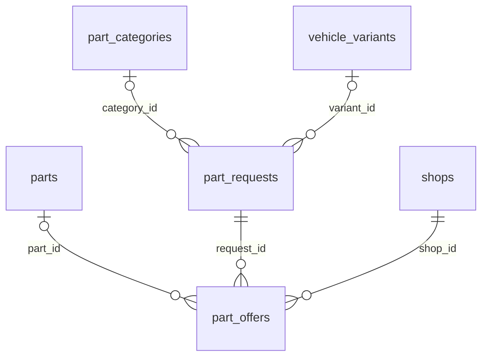

#### `part_requests`

A buyer's request. Open for 3 days (cron `expire-part-requests`), at most 10 open at a time. Status: `OPEN` → `CLOSED` (by the buyer) or `EXPIRED`.

**Access:** The buyer and admins read; shops use `shop_open_requests()`. `create_part_request` / `close_part_request`.

| Column | Type | Null | Default | Notes |
|---|---|---|---|---|
| `id` 🔑 | uuid |  | `gen_random_uuid()` |  |
| `buyer_id` | uuid |  | `auth.uid()` | → `auth.users.id` (cascade) |
| `variant_id` | uuid | yes |  | The buyer's car. → `vehicle_variants.id` |
| `category_id` | uuid | yes |  | → `part_categories.id` |
| `note` | text |  |  | What the buyer is looking for. check: `trimmed length 3–1000` |
| `image_keys` | text[] |  | `'{}'` | Up to 4 photos in `request-photos/{uid}/…`. check: `≤ 4 items` |
| `status` | text |  | `'OPEN'` | check: `OPEN, CLOSED, EXPIRED` |
| `expires_at` | timestamptz |  | `(now() + '3 days')` |  |
| `created_at` | timestamptz |  | `now()` |  |

- Index `part_requests_buyer_idx` on (buyer_id, created_at DESC)
- Index `part_requests_open_idx` on (status, created_at DESC)

#### `part_offers`

A shop's answer to a request: a priced item valid until `valid_until` (48 hours by default). One live offer per shop per request; a new one replaces it. Status: `OFFERED` → `ORDERED` (bought), `WITHDRAWN` or `EXPIRED`.

**Access:** The request's buyer, the shop and admins read. `shop_make_offer` / `shop_withdraw_offer`.

| Column | Type | Null | Default | Notes |
|---|---|---|---|---|
| `id` 🔑 | uuid |  | `gen_random_uuid()` |  |
| `request_id` | uuid |  |  | → `part_requests.id` (cascade) |
| `shop_id` | uuid |  |  | → `shops.id` (cascade) |
| `part_id` | uuid | yes |  | Catalogue part, when the shop linked one. → `parts.id` |
| `title_ar` | text |  |  | Arabic. check: `trimmed length 2–120` |
| `title_en` | text |  | `''` | English. check: `≤ 120 chars` |
| `condition` | listing_condition |  |  |  |
| `price_sdg` | bigint |  |  | check: `1–1000000000` |
| `warranty_days` | integer |  | `0` | check: `0–1825` |
| `note_ar` | text | yes |  | Arabic. check: `≤ 300 chars` |
| `image_key` | text | yes |  | Photo of the offered item. check: `≤ 300 chars` |
| `status` | text |  | `'OFFERED'` | check: `OFFERED, ORDERED, WITHDRAWN, EXPIRED` |
| `valid_until` | timestamptz |  | `(now() + '2 days')` |  |
| `created_by` | uuid | yes |  | → `auth.users.id` (set null) |
| `created_at` | timestamptz |  | `now()` |  |

- Unique index `part_offers_one_active` on (request_id, shop_id) where `status = 'OFFERED'`
- Index `part_offers_request_idx` on (request_id)

### Cart and orders

An order is what the buyer paid for in one checkout. It splits into one sub-order per shop; each sub-order moves through its own status machine ([Sub-order](#sub-order-status)). Prices are copied into `order_items` at checkout and never change after (the price lock).

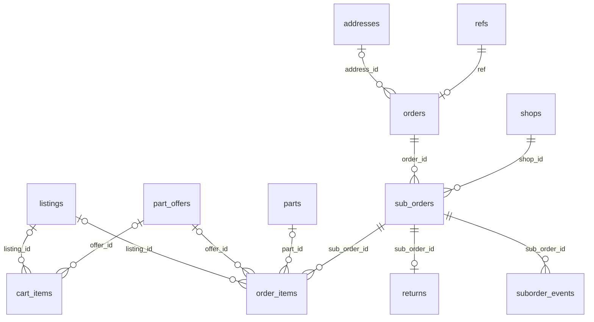

#### `cart_items`

The buyer's cart, synced from the phone. Exactly one of `listing_id` / `offer_id` / `tint_shop_id`; `seen_price_sdg` is the price the buyer saw, re-checked at checkout (`CART_CHANGED`). At most 50 lines; an offer line has quantity 1 and must answer the buyer's own request; a tint line has quantity 1, one per cart, its choice stored canonical by the trigger (D-149).

**Access:** Self reads and writes directly.

| Column | Type | Null | Default | Notes |
|---|---|---|---|---|
| `id` 🔑 | uuid |  | `gen_random_uuid()` |  |
| `user_id` | uuid |  | `auth.uid()` | → `auth.users.id` (cascade) |
| `listing_id` | uuid | yes |  | → `listings.id` (cascade) |
| `offer_id` | uuid | yes |  | → `part_offers.id` (cascade) |
| `tint_shop_id` | uuid | yes |  | Window tint from this shop. → `shops.id` (cascade) |
| `tint` | jsonb | yes |  | The tint choice ([Window tint](#window-tint)) |
| `qty` | integer |  | `1` | check: `1–99` |
| `seen_price_sdg` | bigint |  |  | Price the buyer saw; re-checked at checkout. check: `> 0` |
| `created_at` | timestamptz |  | `now()` |  |
| `updated_at` | timestamptz |  | `now()` | Set by trigger on update |

- Check: `num_nonnulls(listing_id, offer_id, tint_shop_id) = 1` and `tint` set exactly when `tint_shop_id` is
- Unique index `cart_items_listing` on (user_id, listing_id) where `listing_id IS NOT NULL`
- Unique index `cart_items_offer` on (user_id, offer_id) where `offer_id IS NOT NULL`
- Unique index `cart_items_tint` on (user_id) where `tint_shop_id IS NOT NULL` (one tint line per cart)
- Trigger `cart_items_before`: before insert or update → `tg_cart_items_before()`
- Trigger `cart_items_updated_at`: before update → `tg_set_updated_at()`

#### `orders`

One checkout. `ref` is the number the buyer types into the Bankak note. `total_sdg` is always the sum of its parts (checked). Bankak orders must be paid by `pay_by` (`payment_window_minutes`) or they are cancelled (cron `expire-unpaid-orders`). An order can also pay for a fitting (`booking_fee_sdg`, `labour_sdg`, `travel_sdg`, D-097); an order for a fitting alone has no sub-orders.

**Access:** The buyer and admins read.

| Column | Type | Null | Default | Notes |
|---|---|---|---|---|
| `id` 🔑 | uuid |  | `gen_random_uuid()` |  |
| `ref` | text |  |  | 8-digit reference typed into the Bankak note. → `refs.ref` |
| `buyer_id` | uuid |  |  | → `auth.users.id` |
| `payment_method` | payment_method |  |  |  |
| `items_sdg` | bigint |  |  | Sum of the sub-orders' items. check: `>= 0` |
| `delivery_sdg` | bigint |  | `0` | Sum of delivery fees. check: `>= 0` |
| `booking_fee_sdg` | bigint |  | `0` | Platform fee for a fitting paid in this order. check: `>= 0` |
| `labour_sdg` | bigint |  | `0` | Technician's labour for that fitting. check: `>= 0` |
| `travel_sdg` | bigint |  | `0` | Travel fee for that fitting. check: `>= 0` |
| `total_sdg` | bigint |  |  | Always the sum of the five amounts (checked) |
| `pay_by` | timestamptz | yes |  | Bankak only: unpaid orders are cancelled after this (D-015) |
| `address_id` | uuid | yes |  | → `addresses.id` (set null) |
| `address_snapshot` | jsonb | yes |  | Label, directions and point at checkout |
| `idem_key` | uuid | yes |  | The checkout's `p_idem` |
| `created_at` | timestamptz |  | `now()` |  |

- Unique (`buyer_id`, `idem_key`)
- Unique (`ref`)
- Check: `total_sdg = ((((items_sdg + delivery_sdg) + booking_fee_sdg) + labour_sdg) + travel_sdg)`
- Index `orders_buyer_idx` on (buyer_id, created_at DESC)

#### `sub_orders`

One shop's part of an order. Commission rate and amount are snapshots taken at checkout. `shop_ack_at` is the shop tapping "Accept" (D-020); `ack_alert_at` records that admins were told it hadn't. A shop sees a sub-order only once it is paid (or a cash order is placed), and never another shop's part (D-086).

**Access:** The buyer, the shop and admins read. Moves only through `transition_suborder()`.

| Column | Type | Null | Default | Notes |
|---|---|---|---|---|
| `id` 🔑 | uuid |  | `gen_random_uuid()` |  |
| `order_id` | uuid |  |  | → `orders.id` (cascade) |
| `shop_id` | uuid |  |  | → `shops.id` |
| `status` | suborder_status |  |  |  |
| `fulfilment` | fulfilment_type |  |  | Pickup, delivery, or to the technician of a fitting |
| `items_sdg` | bigint |  |  | Sum of its lines. check: `>= 0` |
| `delivery_fee_sdg` | bigint |  | `0` | From `delivery_fee_bands` and the distance (D-087). check: `>= 0` |
| `commission_bp` | integer |  |  | Commission rate in basis points, snapshot at checkout. check: `0–5000` |
| `commission_sdg` | bigint |  |  | Commission on `items_sdg`, rounded half up (D-014). check: `>= 0` |
| `shop_ack_at` | timestamptz | yes |  | The shop tapped "Accept" (D-020) |
| `ready_at` | timestamptz | yes |  | Marked ready |
| `handed_over_at` | timestamptz | yes |  | Picked up, sent out or handed to the technician |
| `delivered_at` | timestamptz | yes |  |  |
| `completed_at` | timestamptz | yes |  |  |
| `cancelled_at` | timestamptz | yes |  |  |
| `cancel_reason` | text | yes |  | check: `≤ 500 chars` |
| `status_changed_at` | timestamptz |  | `now()` | Set by the status guard |
| `created_at` | timestamptz |  | `now()` |  |
| `ack_alert_at` | timestamptz | yes |  | Admins were told the shop hadn't accepted in time |

- Unique (`order_id`, `shop_id`)
- Index `sub_orders_shop_idx` on (shop_id, status)
- Index `sub_orders_status_idx` on (status, status_changed_at)
- Trigger `sub_orders_status_guard`: before update of status → `tg_suborder_status_guard()`

#### `order_items`

The lines of a sub-order, copied from the listing or offer at checkout: title, condition, warranty and unit price. Append-only (the price lock).

**Access:** Whoever can see the sub-order.

| Column | Type | Null | Default | Notes |
|---|---|---|---|---|
| `id` 🔑 | uuid |  | `gen_random_uuid()` |  |
| `sub_order_id` | uuid |  |  | → `sub_orders.id` (cascade) |
| `listing_id` | uuid | yes |  | Exactly one of listing / offer / tint. → `listings.id` |
| `offer_id` | uuid | yes |  | → `part_offers.id` |
| `tint` | jsonb | yes |  | Window tint as bought ([Window tint](#window-tint)); the shop is the sub-order's. Condition `NEW_AFTERMARKET`, no part |
| `part_id` | uuid | yes |  | → `parts.id` |
| `title_ar` | text |  |  | Copied at checkout |
| `title_en` | text |  |  | English |
| `condition` | listing_condition |  |  |  |
| `brand` | text | yes |  |  |
| `warranty_days` | integer |  | `0` |  |
| `unit_price_sdg` | bigint |  |  | Locked at checkout. check: `> 0` |
| `qty` | integer |  |  | check: `1–99` |
| `line_sdg` | bigint |  |  | `unit_price_sdg × qty` (checked) |

- Check: `line_sdg = (unit_price_sdg * qty)`
- Check: `num_nonnulls(listing_id, offer_id, tint) = 1`
- Index `order_items_sub_order_idx` on (sub_order_id)
- Trigger `order_items_append_only`: before delete or update → `tg_append_only()`

#### `suborder_transitions`

The allowed sub-order status changes and who may make each (see [Sub-order status](#sub-order-status)).

**Access:** Signed-in users read.

| Column | Type | Null | Default | Notes |
|---|---|---|---|---|
| `from_status` 🔑 | suborder_status |  |  |  |
| `to_status` 🔑 | suborder_status |  |  |  |
| `actor` 🔑 | text |  |  | check: `BUYER, SHOP, ADMIN, SYSTEM` |

- Primary key (`from_status`, `to_status`, `actor`)

#### `suborder_events`

The history of a sub-order: every status change, who made it and why. Written only by `transition_suborder()`.

**Access:** Whoever can see the sub-order.

| Column | Type | Null | Default | Notes |
|---|---|---|---|---|
| `id` 🔑 | bigint |  | `identity` | Identity |
| `sub_order_id` | uuid |  |  | → `sub_orders.id` (cascade) |
| `from_status` | suborder_status | yes |  | Null for the first event |
| `to_status` | suborder_status |  |  |  |
| `actor_kind` | text |  |  | Who made the change. check: `BUYER, SHOP, ADMIN, SYSTEM` |
| `actor_id` | uuid | yes |  | The user, if any. → `auth.users.id` (set null) |
| `reason` | text | yes |  |  |
| `at` | timestamptz |  | `now()` |  |

- Index `suborder_events_sub_order_idx` on (sub_order_id, at)

#### `returns`

A return request on a whole sub-order (D-085), within `return_window_days` of receiving it. An admin decides: `REQUESTED` → `APPROVED` (stock back, sale reversed, buyer refunded) or `DECLINED`.

**Access:** Whoever can see the sub-order. `request_return` / `admin_decide_return`.

| Column | Type | Null | Default | Notes |
|---|---|---|---|---|
| `id` 🔑 | uuid |  | `gen_random_uuid()` |  |
| `sub_order_id` | uuid |  |  | → `sub_orders.id` (cascade) |
| `reason` | text |  |  | check: `trimmed length 3–500` |
| `status` | text |  | `'REQUESTED'` | check: `REQUESTED, APPROVED, DECLINED` |
| `decided_by` | uuid | yes |  | → `auth.users.id` (set null) |
| `decided_at` | timestamptz | yes |  |  |
| `decision_note` | text | yes |  | Required to decline. check: `≤ 500 chars` |
| `created_at` | timestamptz |  | `now()` |  |

- Unique (`sub_order_id`)

### Payments and refunds

Bankak is a confirmed transfer: a payment is confirmed only by an admin who found it on the bank statement, and one transaction number pays one thing only (D-017, D-084). Cash is collected by the shop (or the technician) at hand-over.

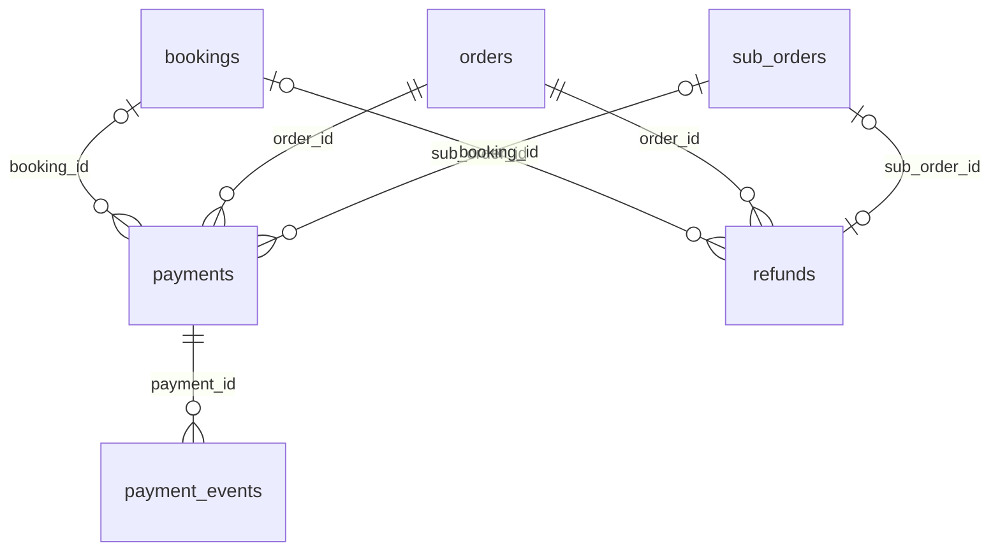

#### `payments`

Money expected from the buyer. A Bankak order has one payment for the whole order; a cash order has one `DUE` payment per shop (`sub_order_id` set). A fitting's deposit is a payment with `purpose = BOOKING_DEPOSIT`. The partial unique index `payments_txn_once` makes a transaction number usable once while submitted or confirmed. Moves only through `transition_payment()`; a Bankak status change on a fitting's payment moves the booking too (`payments_booking` trigger).

**Access:** The buyer; a shop sees only the cash payment of its own sub-order; admins.

| Column | Type | Null | Default | Notes |
|---|---|---|---|---|
| `id` 🔑 | uuid |  | `gen_random_uuid()` |  |
| `order_id` | uuid |  |  | → `orders.id` (cascade) |
| `sub_order_id` | uuid | yes |  | Cash only: the shop that collects it. → `sub_orders.id` (cascade) |
| `booking_id` | uuid | yes |  | Set for a fitting's deposit or a fitting paid alone. → `bookings.id` |
| `purpose` | payment_purpose |  | `'ORDER'` | `BOOKING_DEPOSIT` for a cash fitting's Bankak deposit |
| `method` | payment_method |  |  |  |
| `status` | payment_status |  |  |  |
| `amount_sdg` | bigint |  |  | check: `> 0` |
| `bankak_txn_no` | text | yes |  | Bank transaction number, digits only; usable once. check: `matches '^[0-9]{6,20}$'` |
| `receipt_key` | text | yes |  | Receipt image in `receipts/{uid}/…` |
| `submitted_at` | timestamptz | yes |  | Buyer sent the receipt |
| `reviewed_by` | uuid | yes |  | Admin who confirmed or rejected it. → `auth.users.id` (set null) |
| `reviewed_at` | timestamptz | yes |  |  |
| `reject_reason` | text | yes |  | `AMOUNT_WRONG`, `NOT_ON_STATEMENT`, `DUPLICATE`, `UNREADABLE` or `OTHER` |
| `ref_in_note` | boolean | yes |  | The admin saw the order number in the transfer note |
| `collected_by` | uuid | yes |  | Who took the cash. → `auth.users.id` (set null) |
| `collected_at` | timestamptz | yes |  |  |
| `created_at` | timestamptz |  | `now()` |  |

- Check: `(method = 'CASH') OR (sub_order_id IS NULL)`
- Check: `(method = 'BANKAK') OR ((bankak_txn_no IS NULL) AND (receipt_key IS NULL))`
- Index `payments_booking_idx` on (booking_id)
- Index `payments_order_idx` on (order_id)
- Index `payments_status_idx` on (status, submitted_at)
- Unique index `payments_txn_once` on (bankak_txn_no) where `status in ('RECEIPT_SUBMITTED', 'CONFIRMED')`
- Trigger `payments_booking`: after update of status → `tg_payment_booking()`
- Trigger `payments_status_guard`: before update of status → `tg_payment_status_guard()`

#### `payment_transitions`

The allowed payment status changes and who may make each (see [Payment status](#payment-status)).

**Access:** Signed-in users read.

| Column | Type | Null | Default | Notes |
|---|---|---|---|---|
| `from_status` 🔑 | payment_status |  |  |  |
| `to_status` 🔑 | payment_status |  |  |  |
| `actor` 🔑 | text |  |  | check: `BUYER, SHOP, ADMIN, SYSTEM` |

- Primary key (`from_status`, `to_status`, `actor`)

#### `payment_events`

The history of a payment. Written only by `transition_payment()`.

**Access:** Whoever can see the payment.

| Column | Type | Null | Default | Notes |
|---|---|---|---|---|
| `id` 🔑 | bigint |  | `identity` | Identity |
| `payment_id` | uuid |  |  | → `payments.id` (cascade) |
| `from_status` | payment_status | yes |  |  |
| `to_status` | payment_status |  |  |  |
| `actor_kind` | text |  |  | check: `BUYER, SHOP, ADMIN, SYSTEM` |
| `actor_id` | uuid | yes |  | → `auth.users.id` (set null) |
| `note` | text | yes |  | Reason or admin note |
| `at` | timestamptz |  | `now()` |  |

- Index `payment_events_payment_idx` on (payment_id, at)

#### `refunds`

Money the platform owes back to a buyer, sent by Bankak to the buyer's `profiles.refund_account` (D-088). `PENDING` → `PAID` with the transaction number (`admin_mark_refund_paid`). At most one per sub-order and one per booking.

**Access:** The buyer and admins read.

| Column | Type | Null | Default | Notes |
|---|---|---|---|---|
| `id` 🔑 | uuid |  | `gen_random_uuid()` |  |
| `order_id` | uuid |  |  | → `orders.id` (cascade) |
| `sub_order_id` | uuid | yes |  | → `sub_orders.id` (cascade) |
| `buyer_id` | uuid |  |  | → `auth.users.id` |
| `amount_sdg` | bigint |  |  | check: `> 0` |
| `reason` | text | yes |  |  |
| `status` | text |  | `'PENDING'` | check: `PENDING, PAID` |
| `bankak_txn_no` | text | yes |  | Set when paid. check: `matches '^[0-9]{6,20}$'` |
| `paid_by` | uuid | yes |  | → `auth.users.id` (set null) |
| `paid_at` | timestamptz | yes |  |  |
| `created_at` | timestamptz |  | `now()` |  |
| `booking_id` | uuid | yes |  | → `bookings.id` |

- Unique (`sub_order_id`)
- Check: `(status = 'PAID') = ((bankak_txn_no IS NOT NULL) AND (paid_at IS NOT NULL))`
- Unique index `refunds_booking_once` on (booking_id) where `booking_id IS NOT NULL`
- Index `refunds_status_idx` on (status, created_at)
- Unique index `refunds_txn_once` on (bankak_txn_no) where `bankak_txn_no IS NOT NULL`

### Ledger and payouts

Double-entry, append-only bookkeeping of every amount (D-013, D-081). See [Money](#money) for the accounts and what each event posts.

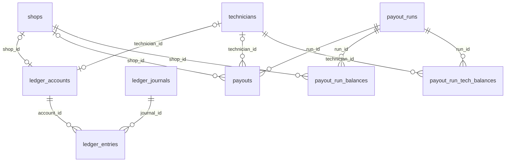

#### `ledger_accounts`

Platform accounts (fixed codes) and one `PARTY` account per shop (`SHOP:<id>`) and technician (`TECH:<id>`), opened on first use by `shop_account()` / `tech_account()`.

**Access:** Admins read.

| Column | Type | Null | Default | Notes |
|---|---|---|---|---|
| `id` 🔑 | uuid |  | `gen_random_uuid()` |  |
| `code` | text |  |  | `PLATFORM_BANKAK`, ..., `SHOP:<id>`, `TECH:<id>` |
| `kind` | text |  |  | `ASSET`, `LIABILITY`, `REVENUE` or `PARTY`. check: `ASSET, LIABILITY, REVENUE, PARTY` |
| `shop_id` | uuid | yes |  | → `shops.id` (set null) |
| `technician_id` | uuid | yes |  | → `technicians.id` (set null) |
| `created_at` | timestamptz |  | `now()` |  |

- Unique (`code`)
- Unique (`shop_id`)
- Unique (`technician_id`)
- Check: `num_nonnulls(shop_id, technician_id) <= 1`

#### `ledger_journals`

One business event (a payment, a sale, a commission, a payout, ...). The ids it points at have no foreign keys on purpose: the ledger outlives what it records. Append-only.

**Access:** Admins read.

| Column | Type | Null | Default | Notes |
|---|---|---|---|---|
| `id` 🔑 | uuid |  | `gen_random_uuid()` |  |
| `kind` | text |  |  | What happened; see [Money](#money). check: `PAYMENT, CASH_COLLECTED, CASH_RETURNED, SALE, SALE_REVERSAL, COMMISSION, COMMISSION_REVERSAL, REFUND, REFUND_PAID, PAYOUT, ADJUSTMENT, BOOKING_FEE, DEPOSIT, LABOUR, TRAVEL_FEE, CASH_HANDOVER` |
| `order_id` | uuid | yes |  |  |
| `sub_order_id` | uuid | yes |  |  |
| `payment_id` | uuid | yes |  |  |
| `payout_id` | uuid | yes |  |  |
| `refund_id` | uuid | yes |  |  |
| `memo` | text | yes |  | Free text, e.g. an adjustment's reason |
| `created_by` | uuid | yes |  | The user whose call posted it. → `auth.users.id` (set null) |
| `created_at` | timestamptz |  | `now()` |  |
| `booking_id` | uuid | yes |  |  |

- Index `ledger_journals_booking_idx` on (booking_id)
- Index `ledger_journals_order_idx` on (order_id)
- Index `ledger_journals_sub_order_idx` on (sub_order_id, kind)
- Trigger `ledger_journals_append_only`: before delete or update → `tg_append_only()`

#### `ledger_entries`

The lines of a journal: positive = debit, negative = credit. The deferred `ledger_entries_balanced` trigger refuses a commit where a journal's lines don't sum to zero (`LEDGER_UNBALANCED`). Append-only.

**Access:** Admins read.

| Column | Type | Null | Default | Notes |
|---|---|---|---|---|
| `id` 🔑 | bigint |  | `identity` | Identity |
| `journal_id` | uuid |  |  | → `ledger_journals.id` |
| `account_id` | uuid |  |  | → `ledger_accounts.id` |
| `amount_sdg` | bigint |  |  | Positive = debit, negative = credit; never 0. check: `<> 0` |

- Index `ledger_entries_account_idx` on (account_id)
- Index `ledger_entries_journal_idx` on (journal_id)
- Trigger `ledger_entries_append_only`: before delete or update → `tg_append_only()`
- Trigger `ledger_entries_balanced`: after insert, deferred to commit → `tg_ledger_balanced()`

#### `payout_runs`

One run of `admin_generate_payouts()`: the period it covers.

**Access:** Admins read.

| Column | Type | Null | Default | Notes |
|---|---|---|---|---|
| `id` 🔑 | uuid |  | `gen_random_uuid()` |  |
| `period_from` | timestamptz | yes |  | Null for the first run |
| `period_to` | timestamptz |  |  |  |
| `created_by` | uuid | yes |  | → `auth.users.id` (set null) |
| `created_at` | timestamptz |  | `now()` |  |

#### `payouts`

What the platform will pay one shop or technician for a run: `DRAFT` → `APPROVED` → `PAID` (posts the `PAYOUT` journal), or `CANCELLED`. One open payout per party. `deductions_sdg` = `sales_sdg` − `amount_sdg` (commission, cash kept, balances carried).

**Access:** The shop's members, the technician and admins read.

| Column | Type | Null | Default | Notes |
|---|---|---|---|---|
| `id` 🔑 | uuid |  | `gen_random_uuid()` |  |
| `run_id` | uuid |  |  | → `payout_runs.id` |
| `shop_id` | uuid | yes |  | → `shops.id` (set null) |
| `technician_id` | uuid | yes |  | → `technicians.id` (set null) |
| `amount_sdg` | bigint |  |  | What will be sent. check: `> 0` |
| `sales_sdg` | bigint |  | `0` | Credited in the period |
| `deductions_sdg` | bigint |  | `0` | `sales_sdg − amount_sdg` |
| `status` | text |  | `'DRAFT'` | check: `DRAFT, APPROVED, PAID, CANCELLED` |
| `bankak_txn_no` | text | yes |  | Set when paid; usable once. check: `matches '^[0-9]{6,20}$'` |
| `approved_by` | uuid | yes |  | → `auth.users.id` (set null) |
| `approved_at` | timestamptz | yes |  |  |
| `paid_by` | uuid | yes |  | → `auth.users.id` (set null) |
| `paid_at` | timestamptz | yes |  |  |
| `cancel_reason` | text | yes |  |  |
| `created_at` | timestamptz |  | `now()` |  |

- Check: `(status = 'PAID') = ((bankak_txn_no IS NOT NULL) AND (paid_at IS NOT NULL))`
- Check: `num_nonnulls(shop_id, technician_id) <= 1`
- Unique index `payouts_one_open` on (shop_id) where `status in ('DRAFT', 'APPROVED')`
- Unique index `payouts_one_open_tech` on (technician_id) where `status in ('DRAFT', 'APPROVED')`
- Index `payouts_run_idx` on (run_id)
- Unique index `payouts_txn_once` on (bankak_txn_no) where `bankak_txn_no IS NOT NULL`

#### `payout_run_balances`

Shops that owed the platform at a run, for "owing for N runs in a row" (D-018).

**Access:** Admins read.

| Column | Type | Null | Default | Notes |
|---|---|---|---|---|
| `run_id` 🔑 | uuid |  |  | → `payout_runs.id` (cascade) |
| `shop_id` 🔑 | uuid |  |  | → `shops.id` (cascade) |
| `balance_sdg` | bigint |  |  | What the shop owed. check: `> 0` |

- Primary key (`run_id`, `shop_id`)

#### `payout_run_tech_balances`

The same for technicians.

**Access:** Admins read.

| Column | Type | Null | Default | Notes |
|---|---|---|---|---|
| `run_id` 🔑 | uuid |  |  | → `payout_runs.id` (cascade) |
| `technician_id` 🔑 | uuid |  |  | → `technicians.id` (cascade) |
| `balance_sdg` | bigint |  |  | What the technician owed. check: `> 0` |

- Primary key (`run_id`, `technician_id`)

### Chat

Text and voice notes between a buyer and a shop (D-033), delivered live through Supabase Realtime.

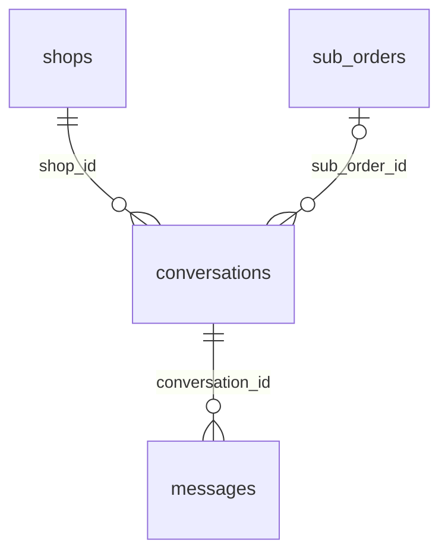

#### `conversations`

One thread per buyer, shop and (optional) sub-order. `buyer_read_at` / `shop_read_at` drive the unread marks.

**Access:** Both sides and admins read. `start_conversation` / `shop_start_conversation` / `mark_conversation_read`.

| Column | Type | Null | Default | Notes |
|---|---|---|---|---|
| `id` 🔑 | uuid |  | `gen_random_uuid()` |  |
| `buyer_id` | uuid |  |  | → `auth.users.id` (cascade) |
| `shop_id` | uuid |  |  | → `shops.id` (cascade) |
| `sub_order_id` | uuid | yes |  | Null for a general chat with the shop. → `sub_orders.id` (set null) |
| `last_message_at` | timestamptz | yes |  | Set by the message trigger |
| `buyer_read_at` | timestamptz | yes |  |  |
| `shop_read_at` | timestamptz | yes |  |  |
| `created_at` | timestamptz |  | `now()` |  |

- Unique (`buyer_id`, `shop_id`, `sub_order_id`), nulls counted as equal
- Index `conversations_buyer_idx` on (buyer_id, last_message_at DESC NULLS LAST)
- Index `conversations_shop_idx` on (shop_id, last_message_at DESC NULLS LAST)

#### `messages`

A message: text, or a voice note (≤ 60 s) stored in `voice-notes/{conversation_id}/…`. Inserting one updates the conversation and alerts the other side (`NEW_MESSAGE`).

**Access:** Both sides and admins read; both sides insert directly.

| Column | Type | Null | Default | Notes |
|---|---|---|---|---|
| `id` 🔑 | uuid |  | `gen_random_uuid()` |  |
| `conversation_id` | uuid |  |  | → `conversations.id` (cascade) |
| `sender_id` | uuid |  | `auth.uid()` | → `auth.users.id` (cascade) |
| `body` | text | yes |  | check: `trimmed length 1–2000` |
| `voice_key` | text | yes |  | Under `voice-notes/{conversation_id}/`. check: `≤ 300 chars` |
| `voice_secs` | integer | yes |  | Length of the voice note. check: `1–60` |
| `created_at` | timestamptz |  | `now()` |  |

- Check: `(body IS NOT NULL) OR ((voice_key IS NOT NULL) AND (voice_secs IS NOT NULL))`
- Index `messages_conversation_idx` on (conversation_id, created_at)
- Trigger `messages_after_insert`: after insert → `tg_messages_after_insert()`
- Trigger `messages_before_insert`: before insert → `tg_messages_before_insert()`

### Notifications

Every alert is a code plus data, never text (D-091). Server code writes `notifications` rows with `notify()`, `notify_shop()`, `notify_partner()` or `notify_admins()`; a trigger queues one delivery per device; the `notify-dispatch` Edge Function words them from the templates and sends them (D-101). Open apps also receive new rows over Realtime (D-142).

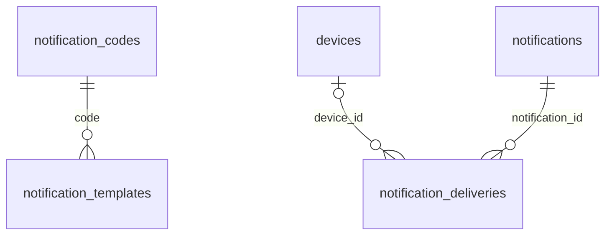

#### `notification_codes`

Every alert code, the app it is for (`buyer`, `partner`, `admin`) and whether it would also go by SMS. See [Alert codes](#alert-codes).

**Access:** Signed-in users read.

| Column | Type | Null | Default | Notes |
|---|---|---|---|---|
| `code` 🔑 | text |  |  | check: `matches '^[A-Z][A-Z_]*$'` |
| `app` | text |  |  | check: `buyer, partner, admin` |
| `sms` | boolean |  | `false` | Would also go by SMS (stubbed until a provider exists) |

#### `notification_templates`

Arabic and English title and body per code, with `{placeholders}` filled from the payload. A test fails if a code lacks either language. Admin edits are audited (D-131).

**Access:** Signed-in users read; admins insert and update.

| Column | Type | Null | Default | Notes |
|---|---|---|---|---|
| `code` 🔑 | text |  |  | → `notification_codes.code` (cascade) |
| `locale` 🔑 | text |  |  | check: `ar, en` |
| `title` | text |  |  | check: `length 1–100` |
| `body` | text |  |  | With `{placeholders}` from the payload. check: `length 1–300` |

- Primary key (`code`, `locale`)
- Trigger `notification_templates_audit`: after insert or update → `tg_audit_template()`

#### `notifications`

A user's in-app inbox. `app` is filled from the code when not given.

**Access:** Self reads; `mark_notifications_read`.

| Column | Type | Null | Default | Notes |
|---|---|---|---|---|
| `id` 🔑 | uuid |  | `gen_random_uuid()` |  |
| `user_id` | uuid |  |  | → `auth.users.id` (cascade) |
| `code` | text |  |  | An alert code, see [Alert codes](#alert-codes). check: `matches '^[A-Z][A-Z_]*$'` |
| `payload` | jsonb |  | `'{}'` | Data the wording and the app need (ids, ref, amounts) |
| `created_at` | timestamptz |  | `now()` |  |
| `read_at` | timestamptz | yes |  |  |
| `app` | text | yes |  | Which app shows it; from `notification_codes` when not given. check: `buyer, partner, admin` |

- Index `notifications_user_idx` on (user_id, created_at DESC)
- Trigger `notifications_app`: before insert → `tg_notifications_app()`
- Trigger `notifications_deliver`: after insert → `tg_notifications_deliver()`

#### `notification_deliveries`

The send queue: one row per device (push) or phone (SMS, recorded as `STUB` until a provider exists). `PENDING` rows are claimed with `SKIP LOCKED` by `notify_claim()` (→ `SENDING`) and reported by `notify_report()` (→ `SENT`, `FAILED`, or back to `PENDING` with backoff of 1, 2, 4, 8 minutes, up to 5 attempts). Rows older than 30 days are deleted.

**Access:** Admins read.

| Column | Type | Null | Default | Notes |
|---|---|---|---|---|
| `id` 🔑 | uuid |  | `gen_random_uuid()` |  |
| `notification_id` | uuid |  |  | → `notifications.id` (cascade) |
| `channel` | notify_channel |  |  |  |
| `device_id` | uuid | yes |  | Push only. → `devices.id` (set null) |
| `target` | text |  |  | FCM token or phone number |
| `locale` | text |  | `'ar'` | check: `ar, en` |
| `status` | text |  | `'PENDING'` | check: `PENDING, SENDING, SENT, FAILED, STUB` |
| `attempts` | integer |  | `0` |  |
| `next_attempt_at` | timestamptz |  | `now()` | When it may be claimed again |
| `last_error` | text | yes |  |  |
| `provider_ref` | text | yes |  | FCM message id |
| `sent_at` | timestamptz | yes |  |  |
| `created_at` | timestamptz |  | `now()` |  |

- Index `notification_deliveries_due_idx` on (next_attempt_at) where `status = 'PENDING'`
- Index `notification_deliveries_notification_idx` on (notification_id)

### Technicians

People who fit parts: what jobs and makes, at what labour price (D-010), where (a bay on the street, the buyer's place within a radius, or both) and when.

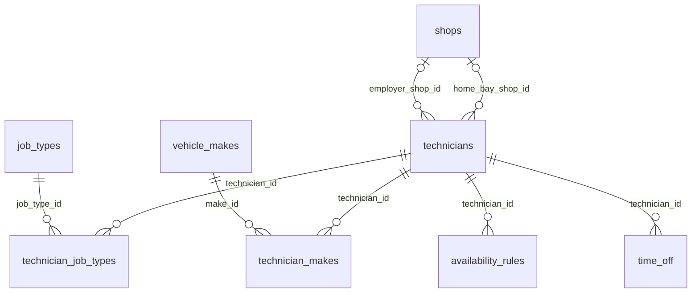

#### `technicians`

A technician, one per user. Starts `PENDING` (`apply_as_technician`); approval grants `TECHNICIAN` and opens the ledger account. `BAY` and `BOTH` need a bay shop; `MOBILE` and `BOTH` need a home point and radius. Ratings and `completed_jobs` are kept by the server.

**Access:** The technician and admins read (buyers use `booking_context` / `technician_profile`). `tech_update_profile`.

| Column | Type | Null | Default | Notes |
|---|---|---|---|---|
| `id` 🔑 | uuid |  | `gen_random_uuid()` |  |
| `user_id` | uuid |  |  | → `auth.users.id` (cascade) |
| `status` | partner_status |  | `'PENDING'` |  |
| `status_reason` | text | yes |  | Why it was rejected or suspended. check: `≤ 500 chars` |
| `verified` | boolean |  | `false` | The "verified" badge |
| `work_mode` | work_mode |  |  |  |
| `home_bay_shop_id` | uuid | yes |  | The workshop bay on the street (`BAY`, `BOTH`). → `shops.id` |
| `home_lat` | float8 | yes |  | Where mobile jobs are measured from (`MOBILE`, `BOTH`). check: `-90–90` |
| `home_lng` | float8 | yes |  | check: `-180–180` |
| `home_point` | geography(Point) | yes |  | **generated**. Generated from `home_lat` / `home_lng` |
| `radius_km` | integer |  | `10` | How far they travel for mobile jobs. check: `1–50` |
| `employer_shop_id` | uuid | yes |  | The shop they work for, if any. → `shops.id` |
| `years_experience` | integer |  | `0` | check: `0–60` |
| `bio_ar` | text | yes |  | Arabic. check: `≤ 500 chars` |
| `bio_en` | text | yes |  | English. check: `≤ 500 chars` |
| `avatar_key` | text | yes |  | Photo in `media-public/users/{uid}/…`. check: `≤ 300 chars` |
| `rating_avg` | numeric(3,2) |  | `0` |  |
| `rating_count` | integer |  | `0` |  |
| `completed_jobs` | integer |  | `0` | Count of completed bookings |
| `approved_at` | timestamptz | yes |  |  |
| `created_at` | timestamptz |  | `now()` |  |
| `updated_at` | timestamptz |  | `now()` | Set by trigger on update |

- Unique (`user_id`)
- Check: `(work_mode = 'MOBILE') OR (home_bay_shop_id IS NOT NULL)`
- Check: `(work_mode = 'BAY') OR ((home_lat IS NOT NULL) AND (home_lng IS NOT NULL))`
- Index `technicians_status_idx` on (status)
- Trigger `technicians_updated_at`: before update → `tg_set_updated_at()`

#### `technician_job_types`

The job types a technician does and the labour price for each, within `labour_price_bounds`.

**Access:** The technician and admins read. `tech_set_job_types`.

| Column | Type | Null | Default | Notes |
|---|---|---|---|---|
| `technician_id` 🔑 | uuid |  |  | → `technicians.id` (cascade) |
| `job_type_id` 🔑 | uuid |  |  | → `job_types.id` |
| `labour_sdg` | bigint |  |  | Labour price for this job type. check: `1–100000000` |

- Primary key (`technician_id`, `job_type_id`)

#### `technician_makes`

Car makes a technician works on. No rows = all makes.

**Access:** The technician and admins read. `tech_set_makes`.

| Column | Type | Null | Default | Notes |
|---|---|---|---|---|
| `technician_id` 🔑 | uuid |  |  | → `technicians.id` (cascade) |
| `make_id` 🔑 | uuid |  |  | → `vehicle_makes.id` |

- Primary key (`technician_id`, `make_id`)

#### `availability_rules`

Weekly working hours in Khartoum wall-clock minutes (0 = Sunday), per kind of job. At most 30 rows per technician.

**Access:** The technician reads and writes directly; admins read.

| Column | Type | Null | Default | Notes |
|---|---|---|---|---|
| `id` 🔑 | uuid |  | `gen_random_uuid()` |  |
| `technician_id` | uuid |  |  | → `technicians.id` (cascade) |
| `weekday` | smallint |  |  | 0 = Sunday … 6 = Saturday. check: `0–6` |
| `start_min` | integer |  |  | Minutes after local midnight. check: `0–1439` |
| `end_min` | integer |  |  | Minutes after local midnight (1440 = midnight). check: `1–1440` |
| `modes` | work_mode |  | `'BOTH'` | Which kind of job these hours are for |
| `created_at` | timestamptz |  | `now()` |  |

- Check: `end_min > start_min`
- Index `availability_rules_tech_idx` on (technician_id, weekday)
- Trigger `availability_rules_limits`: after insert or update → `tg_availability_limits()`

#### `time_off`

Periods a technician can't work (at most 60 days each). `tech_quick_block` adds one from now.

**Access:** The technician reads and writes directly; admins read.

| Column | Type | Null | Default | Notes |
|---|---|---|---|---|
| `id` 🔑 | uuid |  | `gen_random_uuid()` |  |
| `technician_id` | uuid |  |  | → `technicians.id` (cascade) |
| `period` | tstzrange |  |  | Bounded, non-empty range. check: `(NOT isempty(period)) AND (NOT lower_inf(period)) AND (NOT upper_inf(period))` |
| `reason` | text | yes |  | check: `≤ 200 chars` |
| `created_at` | timestamptz |  | `now()` |  |

- Index `time_off_tech_idx` on (technician_id, period) (gist)
- Trigger `time_off_limits`: after insert or update → `tg_availability_limits()`

### Bookings (fittings)

A booking is a fitting job at a time with one technician. It is held while the buyer checks out, paid through an order (D-097), offered to the technician and done on the day. The `bookings_no_overlap` exclusion constraint is the final word on double booking ([Booking status](#booking-status)).

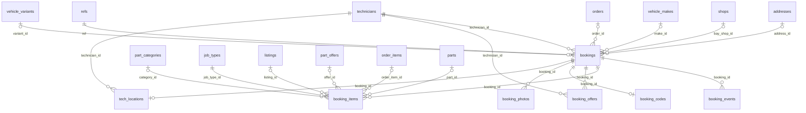

#### `bookings`

A fitting. `start_at`–`end_at` is the job; `block_from`–`block_to` adds the travel buffer on both sides for jobs at the buyer's place (D-025), and that block is what can't overlap another active booking of the same technician. Labour, travel fee, booking fee and deposit are locked when the hold is made (D-100). `assignment_mode = ANY` lets the server pass the job on to another technician.

**Access:** The buyer, its technician and admins read. Moves only through `transition_booking()`.

| Column | Type | Null | Default | Notes |
|---|---|---|---|---|
| `id` 🔑 | uuid |  | `gen_random_uuid()` |  |
| `ref` | text |  |  | 8-digit reference, shared space with orders. → `refs.ref` |
| `buyer_id` | uuid |  |  | → `auth.users.id` |
| `order_id` | uuid | yes |  | The order that paid for it; set at checkout (D-097). → `orders.id` (set null) |
| `technician_id` | uuid |  |  | Current technician; changes on reassignment. → `technicians.id` |
| `assignment_mode` | text |  | `'CHOSEN'` | `CHOSEN` (buyer picked) or `ANY` (first free). check: `CHOSEN, ANY` |
| `place` | booking_place |  |  | At a bay or at the buyer's place |
| `bay_shop_id` | uuid | yes |  | The bay, for `BAY`. → `shops.id` |
| `address_id` | uuid | yes |  | → `addresses.id` (set null) |
| `address_snapshot` | jsonb | yes |  | The address as it was when booked |
| `lat` | float8 | yes |  | check: `-90–90` |
| `lng` | float8 | yes |  | check: `-180–180` |
| `point` | geography(Point) | yes |  | **generated**. Generated from `lat` / `lng` |
| `location_note` | text | yes |  | check: `≤ 300 chars` |
| `make_id` | uuid | yes |  | The car's make (technician makes filter). → `vehicle_makes.id` |
| `variant_id` | uuid | yes |  | → `vehicle_variants.id` |
| `start_at` | timestamptz |  |  | On a half hour, Khartoum time |
| `end_at` | timestamptz |  |  |  |
| `block_from` | timestamptz |  |  | Start of the calendar block (start − travel buffer for mobile jobs) |
| `block_to` | timestamptz |  |  | End of the calendar block (end + travel buffer for mobile jobs) |
| `duration_min` | integer |  |  | Sum of the items' minutes. check: `5–720` |
| `status` | booking_status |  | `'HELD'` |  |
| `hold_expires_at` | timestamptz | yes |  | A `HELD` booking lapses after this (`slot_hold_minutes`) |
| `labour_sdg` | bigint |  |  | Locked at hold time (D-100). check: `>= 0` |
| `travel_fee_sdg` | bigint |  | `0` | From `travel_fee_bands`; 0 at a bay. check: `>= 0` |
| `booking_fee_sdg` | bigint |  | `0` | Platform fee. check: `>= 0` |
| `deposit_sdg` | bigint |  | `0` | Bankak deposit for a cash mobile job (`mobile_deposit_sdg`). check: `>= 0` |
| `payment_method` | payment_method | yes |  | Set at checkout |
| `accepted_at` | timestamptz | yes |  |  |
| `en_route_at` | timestamptz | yes |  |  |
| `checked_in_at` | timestamptz | yes |  |  |
| `completed_at` | timestamptz | yes |  |  |
| `cancelled_at` | timestamptz | yes |  |  |
| `cancel_reason` | text | yes |  | check: `≤ 500 chars` |
| `reminded_day_at` | timestamptz | yes |  | Day-before reminder sent |
| `reminded_hour_at` | timestamptz | yes |  | Hour-before reminder sent |
| `status_changed_at` | timestamptz |  | `now()` |  |
| `created_at` | timestamptz |  | `now()` |  |

- Unique (`ref`)
- **Exclusion** `bookings_no_overlap`: no two rows with the same `technician_id` whose `[block_from, block_to)` ranges overlap, while the status is active (`HELD` … `IN_PROGRESS`)
- Check: `(end_at > start_at) AND (block_from <= start_at) AND (block_to >= end_at)`
- Check: `(place = 'BAY') OR ((lat IS NOT NULL) AND (lng IS NOT NULL))`
- Check: `(place = 'CUSTOMER_LOCATION') OR (bay_shop_id IS NOT NULL)`
- Index `bookings_buyer_idx` on (buyer_id, created_at DESC)
- Unique index `bookings_one_per_order` on (order_id) where `order_id IS NOT NULL`
- Index `bookings_order_idx` on (order_id)
- Index `bookings_status_idx` on (status, start_at)
- Index `bookings_tech_idx` on (technician_id, start_at)
- Trigger `bookings_status_guard`: before update of status → `tg_booking_status_guard()`

#### `booking_transitions`

The allowed booking status changes and who may make each.

**Access:** Signed-in users read.

| Column | Type | Null | Default | Notes |
|---|---|---|---|---|
| `from_status` 🔑 | booking_status |  |  |  |
| `to_status` 🔑 | booking_status |  |  |  |
| `actor` 🔑 | text |  |  | check: `BUYER, TECH, SHOP, ADMIN, SYSTEM` |

- Primary key (`from_status`, `to_status`, `actor`)

#### `booking_events`

The history of a booking. Written only by `transition_booking()`.

**Access:** Whoever can see the booking.

| Column | Type | Null | Default | Notes |
|---|---|---|---|---|
| `id` 🔑 | bigint |  | `identity` | Identity |
| `booking_id` | uuid |  |  | → `bookings.id` (cascade) |
| `from_status` | booking_status | yes |  |  |
| `to_status` | booking_status |  |  |  |
| `actor_kind` | text |  |  | check: `BUYER, TECH, SHOP, ADMIN, SYSTEM` |
| `actor_id` | uuid | yes |  | → `auth.users.id` (set null) |
| `reason` | text | yes |  |  |
| `at` | timestamptz |  | `now()` |  |

- Index `booking_events_booking_idx` on (booking_id, at)

#### `booking_items`

What is being fitted, each with its job type and minutes. Exactly one source: a cart line (listing, offer or window tint, linked to its order item at checkout), an item of an earlier order, or a part bought elsewhere (a catalogue part or just a category, with the buyer's description). Tint carries its shop and choice either way (D-149); fitted at a bay, that shop's bay is the only one allowed (`booking_bay_lock()`).

**Access:** Whoever can see the booking.

| Column | Type | Null | Default | Notes |
|---|---|---|---|---|
| `id` 🔑 | uuid |  | `gen_random_uuid()` |  |
| `booking_id` | uuid |  |  | → `bookings.id` (cascade) |
| `listing_id` | uuid | yes |  | → `listings.id` (set null) |
| `offer_id` | uuid | yes |  | → `part_offers.id` (set null) |
| `order_item_id` | uuid | yes |  | The order line, once paid or for an earlier order. → `order_items.id` (set null) |
| `part_id` | uuid | yes |  | → `parts.id` |
| `category_id` | uuid | yes |  | For a part bought elsewhere, when no catalogue part is known. → `part_categories.id` |
| `job_type_id` | uuid |  |  | → `job_types.id` |
| `tint_shop_id` | uuid | yes |  | Window tint: the shop selling it. → `shops.id` |
| `tint` | jsonb | yes |  | Window tint: the choice ([Window tint](#window-tint)) |
| `minutes` | integer |  |  | Fitting time of this item. check: `5–600` |
| `title_ar` | text |  |  | Arabic |
| `title_en` | text |  |  | English |
| `description` | text | yes |  | Buyer's words for a part bought elsewhere. check: `≤ 300 chars` |

- Index `booking_items_booking_idx` on (booking_id)
- Index `booking_items_order_item_idx` on (order_item_id)

#### `booking_offers`

Each technician the job was offered to (D-024). One open offer per booking; it must be answered by `expires_at` (`tech_accept_timeout_minutes`). Decline and timeout are offer statuses; the booking stays `PENDING_TECH_ACCEPT` while the next technician is asked (D-102).

**Access:** The technician offered and admins read. `tech_respond_offer`.

| Column | Type | Null | Default | Notes |
|---|---|---|---|---|
| `id` 🔑 | uuid |  | `gen_random_uuid()` |  |
| `booking_id` | uuid |  |  | → `bookings.id` (cascade) |
| `technician_id` | uuid |  |  | → `technicians.id` |
| `status` | offer_status |  | `'OFFERED'` |  |
| `offered_at` | timestamptz |  | `now()` |  |
| `expires_at` | timestamptz |  |  |  |
| `responded_at` | timestamptz | yes |  |  |
| `reason` | text | yes |  | Why the technician declined. check: `≤ 300 chars` |

- Index `booking_offers_expiry_idx` on (expires_at) where `status = 'OFFERED'`
- Unique index `booking_offers_one_open` on (booking_id) where `status = 'OFFERED'`
- Index `booking_offers_tech_idx` on (technician_id, status)

#### `booking_codes`

The 4-digit code the buyer gives the technician to finish the job (D-028, D-103), kept apart so only the buyer can read it. Five wrong tries lock it (`locked_at`) and admins are told.

**Access:** The buyer and admins read.

| Column | Type | Null | Default | Notes |
|---|---|---|---|---|
| `booking_id` 🔑 | uuid |  |  | → `bookings.id` (cascade) |
| `code` | text |  |  | check: `matches '^[0-9]{4}$'` |
| `attempts` | integer |  | `0` | Wrong tries so far |
| `locked_at` | timestamptz | yes |  | Set at the fifth wrong try |

#### `booking_photos`

Before and after photos the technician takes (`booking-photos/{booking_id}/…`), up to 10.

**Access:** Whoever can see the booking. `tech_add_photo`.

| Column | Type | Null | Default | Notes |
|---|---|---|---|---|
| `id` 🔑 | uuid |  | `gen_random_uuid()` |  |
| `booking_id` | uuid |  |  | → `bookings.id` (cascade) |
| `kind` | text |  |  | check: `BEFORE, AFTER` |
| `image_key` | text |  |  | Under `booking-photos/{booking_id}/`. check: `≤ 300 chars` |
| `created_by` | uuid | yes |  | → `auth.users.id` (set null) |
| `taken_at` | timestamptz |  | `now()` |  |

- Index `booking_photos_booking_idx` on (booking_id)

#### `tech_locations`

The technician's live position while `EN_ROUTE` only (D-029); deleted at check-in. Sent over Realtime.

**Access:** The technician, the buyer while `EN_ROUTE`, and admins.

| Column | Type | Null | Default | Notes |
|---|---|---|---|---|
| `booking_id` 🔑 | uuid |  |  | → `bookings.id` (cascade) |
| `technician_id` | uuid |  |  | → `technicians.id` (cascade) |
| `lat` | float8 |  |  | check: `-90–90` |
| `lng` | float8 |  |  | check: `-180–180` |
| `updated_at` | timestamptz |  | `now()` | Set by trigger on update |

### Reviews and disputes

Buyers rate the shop for each sub-order and the technician for each fitting, separately (D-105). Disputes are complaint tickets between the parties and the admins (D-132).

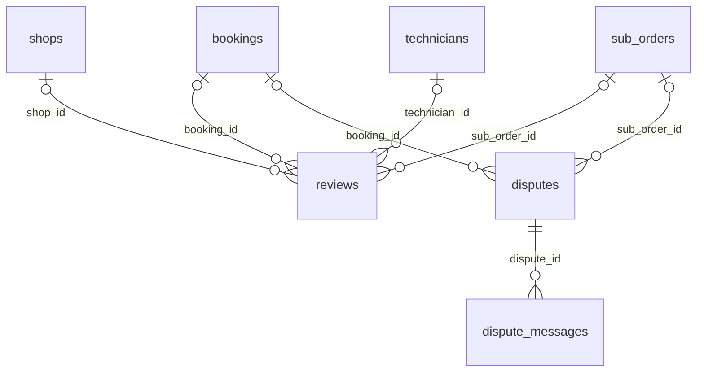

#### `reviews`

A rating (1–5) with an optional comment, either of a shop for a sub-order or of a technician for a booking (checked). One per author per sub-order / booking. Hidden reviews (`hidden_at`) don't count; the `reviews_rollup` trigger keeps the shop's and technician's averages.

**Access:** The author, the reviewed shop or technician, and admins read (buyers use `reviews_for()`). `create_review` / `admin_hide_review`.

| Column | Type | Null | Default | Notes |
|---|---|---|---|---|
| `id` 🔑 | uuid |  | `gen_random_uuid()` |  |
| `author_id` | uuid |  |  | → `auth.users.id` (cascade) |
| `sub_order_id` | uuid | yes |  | → `sub_orders.id` (cascade) |
| `booking_id` | uuid | yes |  | → `bookings.id` (cascade) |
| `shop_id` | uuid | yes |  | → `shops.id` (cascade) |
| `technician_id` | uuid | yes |  | → `technicians.id` (cascade) |
| `rating` | smallint |  |  | check: `1–5` |
| `comment` | text | yes |  | check: `≤ 500 chars` |
| `hidden_at` | timestamptz | yes |  | Hidden by an admin; not counted |
| `hidden_reason` | text | yes |  | check: `≤ 300 chars` |
| `created_at` | timestamptz |  | `now()` |  |
| `updated_at` | timestamptz |  | `now()` | Set by trigger on update |

- Check: `((shop_id IS NOT NULL) AND (sub_order_id IS NOT NULL) AND (technician_id IS NULL) AND (booking_id IS NULL)) OR ((technician_id IS NOT NULL) AND (booking_id IS NOT NULL) AND (shop_id IS NULL) AND (sub_order_id IS NULL))`
- Unique index `reviews_one_per_booking` on (author_id, booking_id) where `booking_id IS NOT NULL`
- Unique index `reviews_one_per_sub_order` on (author_id, sub_order_id) where `sub_order_id IS NOT NULL`
- Index `reviews_shop_idx` on (shop_id, created_at DESC) where `shop_id IS NOT NULL`
- Index `reviews_tech_idx` on (technician_id, created_at DESC) where `technician_id IS NOT NULL`
- Trigger `reviews_rollup`: after insert or delete or update → `tg_reviews_rollup()`
- Trigger `reviews_updated_at`: before update → `tg_set_updated_at()`

#### `disputes`

A complaint about one sub-order or one booking, opened by the buyer, a member of the shop or the technician. `OPEN` → `IN_REVIEW` → `RESOLVED` or `REJECTED` (a resolution is required to close). One open dispute per person per order or booking.

**Access:** The parties and admins read. `open_dispute` / `admin_update_dispute`.

| Column | Type | Null | Default | Notes |
|---|---|---|---|---|
| `id` 🔑 | uuid |  | `gen_random_uuid()` |  |
| `opened_by` | uuid |  |  | → `auth.users.id` (cascade) |
| `opener_role` | text |  |  | Which side opened it. check: `BUYER, SHOP, TECH` |
| `sub_order_id` | uuid | yes |  | → `sub_orders.id` (cascade) |
| `booking_id` | uuid | yes |  | → `bookings.id` (cascade) |
| `category` | text |  |  | check: `NOT_RECEIVED, WRONG_PART, DAMAGED, NOT_FITTED, PAYMENT, BEHAVIOUR, OTHER` |
| `description` | text |  |  | check: `trimmed length 10–2000` |
| `status` | text |  | `'OPEN'` | check: `OPEN, IN_REVIEW, RESOLVED, REJECTED` |
| `assigned_to` | uuid | yes |  | Admin handling it. → `auth.users.id` (set null) |
| `resolution` | text | yes |  | check: `≤ 1000 chars` |
| `resolved_at` | timestamptz | yes |  |  |
| `created_at` | timestamptz |  | `now()` |  |
| `updated_at` | timestamptz |  | `now()` | Set by trigger on update |

- Check: `num_nonnulls(sub_order_id, booking_id) = 1`
- Check: `(status in ('RESOLVED', 'REJECTED')) = ((resolution IS NOT NULL) AND (resolved_at IS NOT NULL))`
- Unique index `disputes_one_open` on (opened_by, COALESCE(sub_order_id, booking_id)) where `status in ('OPEN', 'IN_REVIEW')`
- Index `disputes_status_idx` on (status, created_at)
- Trigger `disputes_updated_at`: before update → `tg_set_updated_at()`

#### `dispute_messages`

Replies on a dispute, from a party or an admin (`from_admin`).

**Access:** The parties and admins read. `dispute_reply`.

| Column | Type | Null | Default | Notes |
|---|---|---|---|---|
| `id` 🔑 | uuid |  | `gen_random_uuid()` |  |
| `dispute_id` | uuid |  |  | → `disputes.id` (cascade) |
| `sender_id` | uuid |  |  | → `auth.users.id` (cascade) |
| `from_admin` | boolean |  | `false` |  |
| `body` | text |  |  | check: `trimmed length 1–2000` |
| `created_at` | timestamptz |  | `now()` |  |

- Index `dispute_messages_dispute_idx` on (dispute_id, created_at)

## Status machines

A status column changes only when (`from`, `to`, actor) is a row of its transition table. The actor is what the calling function declared in the `app.actor` setting (`BUYER`, `SHOP`, `TECH`, `ADMIN`, `SYSTEM` for timed jobs); an `UPDATE` with no declared actor is refused, even from the SQL editor (`INVALID_TRANSITION`). Only `transition_suborder()`, `transition_payment()` and `transition_booking()` declare an actor; each writes the event row and applies the side effects of the new status (stock, cash, ledger, refunds, alerts).

### Sub-order status

`suborder_transitions`, guarded by `sub_orders_status_guard`. A Bankak sub-order starts `PENDING_PAYMENT` and goes to `PAYMENT_REVIEW` when the buyer sends the receipt; a cash sub-order starts at `CONFIRMED`. Picked-up and delivered sub-orders complete on their own after `auto_complete_days`; a fitting's parts (`HANDED_TO_TECHNICIAN`) complete with the booking. `SYSTEM` cancels unpaid orders after `pay_by` and the parts of a fitting that was cancelled.

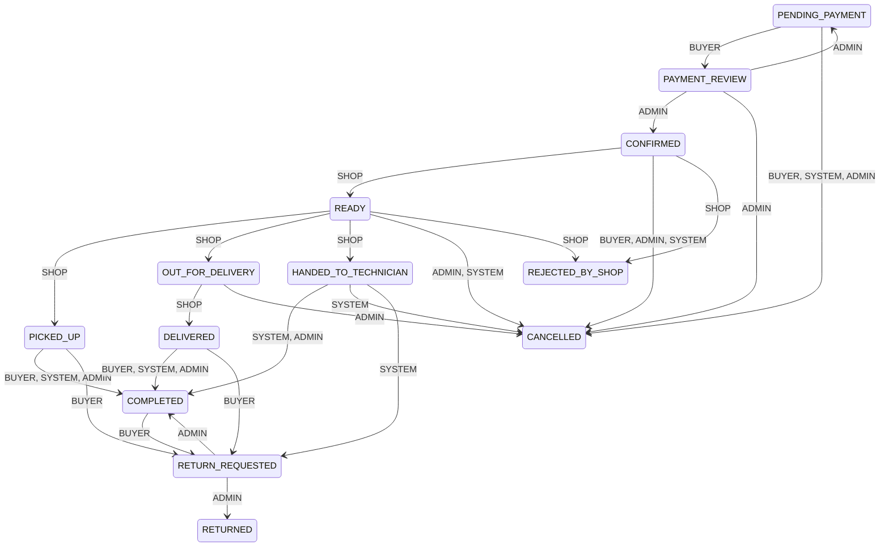

| From | To | Who |
|---|---|---|
| `PENDING_PAYMENT` | `PAYMENT_REVIEW` | BUYER |
| `PENDING_PAYMENT` | `CANCELLED` | BUYER, SYSTEM, ADMIN |
| `PAYMENT_REVIEW` | `PENDING_PAYMENT` | ADMIN |
| `PAYMENT_REVIEW` | `CONFIRMED` | ADMIN |
| `PAYMENT_REVIEW` | `CANCELLED` | ADMIN |
| `CONFIRMED` | `READY` | SHOP |
| `CONFIRMED` | `CANCELLED` | BUYER, ADMIN, SYSTEM |
| `CONFIRMED` | `REJECTED_BY_SHOP` | SHOP |
| `READY` | `PICKED_UP` | SHOP |
| `READY` | `OUT_FOR_DELIVERY` | SHOP |
| `READY` | `HANDED_TO_TECHNICIAN` | SHOP |
| `READY` | `CANCELLED` | ADMIN, SYSTEM |
| `READY` | `REJECTED_BY_SHOP` | SHOP |
| `PICKED_UP` | `COMPLETED` | BUYER, SYSTEM, ADMIN |
| `PICKED_UP` | `RETURN_REQUESTED` | BUYER |
| `OUT_FOR_DELIVERY` | `DELIVERED` | SHOP |
| `OUT_FOR_DELIVERY` | `CANCELLED` | ADMIN |
| `DELIVERED` | `COMPLETED` | BUYER, SYSTEM, ADMIN |
| `DELIVERED` | `RETURN_REQUESTED` | BUYER |
| `HANDED_TO_TECHNICIAN` | `COMPLETED` | SYSTEM, ADMIN |
| `HANDED_TO_TECHNICIAN` | `CANCELLED` | SYSTEM |
| `HANDED_TO_TECHNICIAN` | `RETURN_REQUESTED` | SYSTEM |
| `COMPLETED` | `RETURN_REQUESTED` | BUYER |
| `RETURN_REQUESTED` | `COMPLETED` | ADMIN |
| `RETURN_REQUESTED` | `RETURNED` | ADMIN |

### Payment status

`payment_transitions`, guarded by `payments_status_guard`. Bankak: `AWAITING_TRANSFER` → `RECEIPT_SUBMITTED` → `CONFIRMED` or `REJECTED` (the buyer may send again until `pay_by`). Cash: `DUE` → `COLLECTED` when the shop hands over (pickup) or delivers.

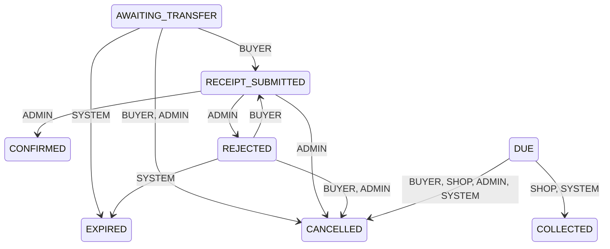

| From | To | Who |
|---|---|---|
| `AWAITING_TRANSFER` | `RECEIPT_SUBMITTED` | BUYER |
| `AWAITING_TRANSFER` | `EXPIRED` | SYSTEM |
| `AWAITING_TRANSFER` | `CANCELLED` | BUYER, ADMIN |
| `RECEIPT_SUBMITTED` | `CONFIRMED` | ADMIN |
| `RECEIPT_SUBMITTED` | `REJECTED` | ADMIN |
| `RECEIPT_SUBMITTED` | `CANCELLED` | ADMIN |
| `REJECTED` | `RECEIPT_SUBMITTED` | BUYER |
| `REJECTED` | `EXPIRED` | SYSTEM |
| `REJECTED` | `CANCELLED` | BUYER, ADMIN |
| `DUE` | `COLLECTED` | SHOP, SYSTEM |
| `DUE` | `CANCELLED` | BUYER, SHOP, ADMIN, SYSTEM |

### Booking status

`booking_transitions`, guarded by `bookings_status_guard`. Statuses `HELD` … `IN_PROGRESS` are active: they block the technician's calendar (`bookings_no_overlap`). A cash fitting at a bay skips `AWAITING_PAYMENT`. A declined or timed-out offer passes the job to the next suitable technician while the status stays `PENDING_TECH_ACCEPT` (`booking_offers`); if nobody is free it goes to `NEEDS_RESCHEDULE`, where the buyer picks a new time or cancels for a full refund. `EN_ROUTE` is for jobs at the buyer's place only. A booking with parts bought for it can't start until the technician has collected them (`PARTS_NOT_COLLECTED`).

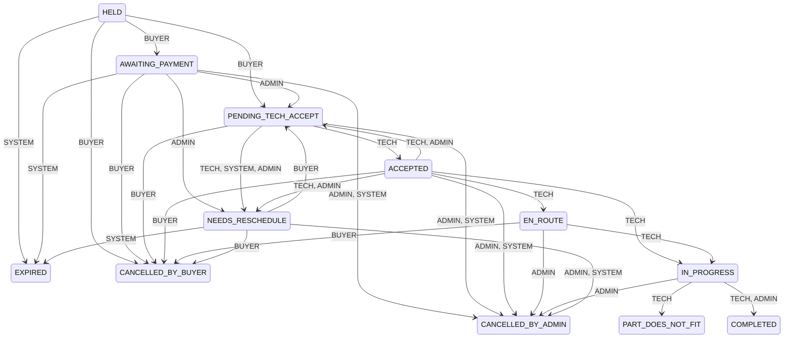

| From | To | Who |
|---|---|---|
| `HELD` | `AWAITING_PAYMENT` | BUYER |
| `HELD` | `PENDING_TECH_ACCEPT` | BUYER |
| `HELD` | `EXPIRED` | SYSTEM |
| `HELD` | `CANCELLED_BY_BUYER` | BUYER |
| `AWAITING_PAYMENT` | `PENDING_TECH_ACCEPT` | ADMIN |
| `AWAITING_PAYMENT` | `NEEDS_RESCHEDULE` | ADMIN |
| `AWAITING_PAYMENT` | `EXPIRED` | SYSTEM |
| `AWAITING_PAYMENT` | `CANCELLED_BY_BUYER` | BUYER |
| `AWAITING_PAYMENT` | `CANCELLED_BY_ADMIN` | ADMIN, SYSTEM |
| `PENDING_TECH_ACCEPT` | `ACCEPTED` | TECH |
| `PENDING_TECH_ACCEPT` | `NEEDS_RESCHEDULE` | TECH, SYSTEM, ADMIN |
| `PENDING_TECH_ACCEPT` | `CANCELLED_BY_BUYER` | BUYER |
| `PENDING_TECH_ACCEPT` | `CANCELLED_BY_ADMIN` | ADMIN, SYSTEM |
| `ACCEPTED` | `PENDING_TECH_ACCEPT` | TECH, ADMIN |
| `ACCEPTED` | `EN_ROUTE` | TECH |
| `ACCEPTED` | `IN_PROGRESS` | TECH |
| `ACCEPTED` | `NEEDS_RESCHEDULE` | TECH, ADMIN |
| `ACCEPTED` | `CANCELLED_BY_BUYER` | BUYER |
| `ACCEPTED` | `CANCELLED_BY_ADMIN` | ADMIN, SYSTEM |
| `EN_ROUTE` | `IN_PROGRESS` | TECH |
| `EN_ROUTE` | `CANCELLED_BY_BUYER` | BUYER |
| `EN_ROUTE` | `CANCELLED_BY_ADMIN` | ADMIN |
| `IN_PROGRESS` | `COMPLETED` | TECH, ADMIN |
| `IN_PROGRESS` | `CANCELLED_BY_ADMIN` | ADMIN |
| `IN_PROGRESS` | `PART_DOES_NOT_FIT` | TECH |
| `NEEDS_RESCHEDULE` | `PENDING_TECH_ACCEPT` | BUYER |
| `NEEDS_RESCHEDULE` | `EXPIRED` | SYSTEM |
| `NEEDS_RESCHEDULE` | `CANCELLED_BY_BUYER` | BUYER |
| `NEEDS_RESCHEDULE` | `CANCELLED_BY_ADMIN` | ADMIN, SYSTEM |

### Other statuses

| Table | Values | Flow |
|---|---|---|
| `part_requests.status` | `OPEN`, `CLOSED`, `EXPIRED` | Closed by the buyer, or expired after 3 days |
| `part_offers.status` | `OFFERED`, `ORDERED`, `WITHDRAWN`, `EXPIRED` | Ordered at checkout; withdrawn by the shop; expired with the request or after `valid_until` |
| `returns.status` | `REQUESTED`, `APPROVED`, `DECLINED` | An admin decides |
| `refunds.status` | `PENDING`, `PAID` | Paid when the admin records the Bankak transaction |
| `payouts.status` | `DRAFT`, `APPROVED`, `PAID`, `CANCELLED` | Generated as drafts, approved, then paid with a transaction number |
| `disputes.status` | `OPEN`, `IN_REVIEW`, `RESOLVED`, `REJECTED` | Admins; closing needs a resolution |
| `booking_offers.status` (`offer_status`) | `OFFERED`, `ACCEPTED`, `DECLINED`, `TIMED_OUT`, `WITHDRAWN` | The technician answers within `tech_accept_timeout_minutes`, or it times out (cron) |
| `notification_deliveries.status` | `PENDING`, `SENDING`, `SENT`, `FAILED`, `STUB` | Claimed by the dispatcher, reported back, retried with backoff |
| `shops.status`, `technicians.status` (`partner_status`) | `PENDING`, `APPROVED`, `REJECTED`, `SUSPENDED` | `PENDING → APPROVED/REJECTED`, `APPROVED ⇄ SUSPENDED`, `REJECTED → APPROVED` (admins) |

## Money

Every amount moves through the double-entry ledger (D-013, D-081). A journal (`ledger_journals`) has two or more entries (`ledger_entries`) that sum to zero: positive = debit, negative = credit. Both tables are append-only (`APPEND_ONLY`); a mistake is corrected by a new journal. Journals are posted with `post_journal()` (orders) and `post_booking_journal()` (fittings).

### Accounts

| Code | Kind | Meaning |
|---|---|---|
| `PLATFORM_BANKAK` | `ASSET` | Money in the platform's Bankak account |
| `BUYER_FUNDS_HELD` | `LIABILITY` | Buyers' money held until the order or fitting is done. Ends at zero for every finished order |
| `REFUNDS_PAYABLE` | `LIABILITY` | Refunds the platform still has to send |
| `REVENUE_COMMISSION` | `REVENUE` | Commission on part sales |
| `REVENUE_BOOKING_FEE` | `REVENUE` | Booking fees on fittings |
| `ADJUSTMENTS` | `REVENUE` | The other side of manual balance corrections (D-130) |
| `SHOP:<shop id>` | `PARTY` | One per shop. Credit balance = the platform owes the shop; debit = the shop owes the platform (commission on cash it kept), netted from later payouts (D-018) |
| `TECH:<technician id>` | `PARTY` | One per technician, the same way: labour and travel fees earned, minus booking fees on cash jobs they kept |

### What each event posts

A = a sub-order's items + delivery fee, K = its commission; L = labour, T = travel fee, F = booking fee.

| Event | Journal kind | Debit | Credit | Amount |
|---|---|---|---|---|
| Bankak payment confirmed (order or fitting deposit) | `PAYMENT` | `PLATFORM_BANKAK` | `BUYER_FUNDS_HELD` | What was paid |
| Cash collected by the shop | `CASH_COLLECTED` | `SHOP` | `BUYER_FUNDS_HELD` | A |
| Sub-order completed | `SALE` | `BUYER_FUNDS_HELD` | `SHOP` | A |
| | `COMMISSION` | `SHOP` | `REVENUE_COMMISSION` | K |
| Refund owed (Bankak) | `REFUND` | `BUYER_FUNDS_HELD` | `REFUNDS_PAYABLE` | What is refunded |
| Refund sent | `REFUND_PAID` | `REFUNDS_PAYABLE` | `PLATFORM_BANKAK` | |
| Cash given back by the shop | `CASH_RETURNED` | `BUYER_FUNDS_HELD` | `SHOP` | A |
| Return approved after the sale | `SALE_REVERSAL`, `COMMISSION_REVERSAL` | the reverse of `SALE` and `COMMISSION` | | then the refund |
| Fitting completed | `LABOUR`, `TRAVEL_FEE` | `BUYER_FUNDS_HELD` | `TECH` | L, T |
| | `BOOKING_FEE` | `BUYER_FUNDS_HELD` | `REVENUE_BOOKING_FEE` | F |
| Cash taken by the technician | `CASH_COLLECTED` | `TECH` | `BUYER_FUNDS_HELD` | What was taken |
| Technician pays the shop for parts (cash fitting, at hand-over) | `CASH_HANDOVER` | `SHOP` | `TECH` | The parts' items total; posted the other way round if the parts are cancelled or returned |
| Part does not fit | `TRAVEL_FEE` only (D-019) | | | |
| Late buyer cancellation | `BOOKING_FEE`, then `TRAVEL_FEE`, up to what was paid upfront (D-099) | | | |
| Payout paid | `PAYOUT` | `SHOP` / `TECH` | `PLATFORM_BANKAK` | The payout |
| Manual correction | `ADJUSTMENT` | `ADJUSTMENTS` or the party | the other | (D-130) |

The `kind` check also allows `DEPOSIT`, but nothing posts it: a fitting's deposit is a `PAYMENT` like any other.

Balances: `account_balance(id)`, `shop_balance(shop_id)` and `tech_balance(technician_id)` (positive = the platform owes them). Statements for partners: `shop_statement()` / `tech_statement()`; for admins: `admin_partner_balances()`.

## Settings

Rows of `app_settings`, read with `setting(key)` / `setting_int(key)`. **Public** keys reach the apps through `public_settings()`. Values shown are the seeded defaults; the SDG amounts are placeholders until the owner confirms them (D-034).

| Key | Default | Public | Meaning |
|---|---|---|---|
| `commission_percent` | `5` |  | Platform commission on part sales, percent (maths in basis points) |
| `booking_fee_sdg` | `2000` | yes | Platform fee per installation booking |
| `mobile_deposit_sdg` | `5000` | yes | Bankak deposit for cash-paid mobile bookings; 0 disables |
| `slot_hold_minutes` | `10` | yes | How long a chosen slot is held during checkout |
| `tech_accept_timeout_minutes` | `20` |  | Technician must accept an offer within this time |
| `cancel_cutoff_hours` | `6` | yes | Free cancellation until this many hours before start |
| `part_ready_buffer_minutes` | `120` |  | Earliest booking start after checkout |
| `travel_fee_bands` | `[{"sdg":3000,"max_km":3},{"sdg":6000,"max_km":8},{"sdg":10000,"max_km":15}]` | yes | Travel fee by straight-line km from the street; beyond the last band is not served |
| `delivery_fee_bands` | `[{"sdg":2000,"max_km":3},{"sdg":4000,"max_km":8},{"sdg":7000,"max_km":15}]` | yes | Delivery fee by km from the shop |
| `bankak_account_name` | `"TODO: platform account name"` | yes | Shown to buyers on Bankak checkout |
| `bankak_account_number` | `"TODO: platform account number"` | yes | Shown to buyers on Bankak checkout |
| `payout_schedule` | `{"weekday":0,"frequency":"weekly"}` |  | Partner payouts; weekday 0 = Sunday |
| `payment_window_minutes` | `120` | yes | Unpaid Bankak orders auto-cancel after this |
| `return_window_days` | `3` | yes | Days after hand-over that a return can be requested |
| `travel_buffer_minutes` | `30` |  | Gap kept around mobile jobs for travel |
| `booking_lookahead_days` | `7` | yes | How far ahead technician availability is shown |
| `auto_complete_days` | `3` |  | Picked-up/delivered sub-orders complete after this if the buyer is silent |
| `labour_price_bounds` | `{}` |  | Optional min/max labour SDG per job type code |
| `latest_app_versions` | `{"buyer":{"apk_url":null,"min_build":1,"latest_build":1},"partner":{"apk_url":null,"min_build":1,"latest_build":1}}` | yes | Newest and minimum Android builds and where to download them (D-058) |
| `support_phone` | `""` | yes | Support number shown in the apps; also for password help (D-064) |
| `support_whatsapp` | `""` | yes | Support WhatsApp number shown in the apps |

A new key needs a default row (in a migration) and a shape check in `validate_setting()`; `admin_update_setting()` refuses anything else (`INVALID_SETTING`).

## Alert codes

Rows of `notification_codes`. Each has Arabic and English wording in `notification_templates` (a test fails otherwise). **SMS** codes would also be texted once a provider exists; for now those deliveries are recorded as `STUB`.

| App | Codes |
|---|---|
| `buyer` | `ORDER_PLACED`, `PAYMENT_CONFIRMED` (SMS), `PAYMENT_REJECTED` (SMS), `ORDER_READY`, `ORDER_HANDED_OVER`, `ORDER_DELIVERED`, `ORDER_CANCELLED`, `ORDER_REJECTED_BY_SHOP` (SMS), `RETURN_APPROVED`, `RETURN_DECLINED`, `REFUND_CREATED`, `REFUND_PAID` (SMS), `NEW_OFFER`, `NEW_MESSAGE`, `BOOKING_ACCEPTED` (SMS), `BOOKING_REASSIGNED`, `BOOKING_NEEDS_RESCHEDULE` (SMS), `BOOKING_CANCELLED` (SMS), `BOOKING_COMPLETED`, `TECH_EN_ROUTE` (SMS), `TECH_ARRIVED`, `PART_DOES_NOT_FIT`, `BOOKING_REMINDER_DAY` (SMS), `BOOKING_REMINDER_HOUR` (SMS), `DISPUTE_REPLY`, `DISPUTE_RESOLVED` |
| `partner` | `NEW_ORDER` (SMS), `NEW_PART_REQUEST`, `RETURN_REQUESTED`, `PAYOUT_PAID`, `NEW_JOB_OFFER` (SMS), `TECHNICIAN_STATUS`, `PARTS_READY`, `TECH_WILL_COLLECT`, `NEW_REVIEW`, `DISPUTE_FILED` |
| `admin` | `SHOP_NOT_ACKNOWLEDGED`, `JOB_CODE_LOCKED`, `DISPUTE_OPENED` |

## Timed jobs

pg_cron jobs. Each calls a plain SQL function the tests can also call. Times are UTC.

| Job | Schedule | Runs | Does |
|---|---|---|---|
| `alert-unacknowledged-orders` | `*/5 * * * *` | `select public.alert_unacknowledged_orders()` | Tells admins about paid sub-orders a shop hasn't accepted within 30 minutes (D-020; `SHOP_NOT_ACKNOWLEDGED`) |
| `auto-complete-suborders` | `7 * * * *` | `select public.auto_complete_suborders()` | Completes picked-up or delivered sub-orders after `auto_complete_days` |
| `booking-reminders` | `*/5 * * * *` | `select public.send_booking_reminders()` | Day-before and hour-before reminders for accepted fittings |
| `expire-booking-holds` | `* * * * *` | `select public.expire_booking_holds()` | Lapsed `HELD` bookings → `EXPIRED` |
| `expire-booking-offers` | `* * * * *` | `select public.expire_booking_offers()` | Unanswered job offers time out and the job moves on |
| `expire-part-requests` | `13 * * * *` | `select public.expire_part_requests()` | Photo requests past `expires_at` → `EXPIRED`, with their offers |
| `expire-unpaid-orders` | `*/5 * * * *` | `select public.expire_unpaid_orders()` | Bankak orders past `pay_by` with no receipt are cancelled, stock and holds released |
| `idempotency-keys-cleanup` | `17 3 * * *` | `delete from public.idempotency_keys where created_at < now() - interval '7 days'` | Deletes idempotency keys older than 7 days |
| `notify-cleanup` | `17 3 * * *` | `delete from public.notification_deliveries where created_at < now() - interval '30 days'` | Deletes deliveries older than 30 days |
| `notify-dispatch` | `* * * * *` | `select public.kick_notify_dispatch()` | Calls the `notify-dispatch` Edge Function through pg_net when deliveries are waiting |

## Storage

Supabase Storage buckets. Private files live under a folder named after what they belong to, and the policies on `storage.objects` check that folder.

| Bucket | Public | Size limit | Types | Holds | Access |
|---|---|---|---|---|---|
| `app-releases` | yes | 50 MB | apk | APKs for the download page (D-058, D-138) | Admins |
| `booking-photos` |  | 5 MB | webp, jpeg, png | `{booking_id}/…`: before and after photos | The booking's technician writes; whoever can see the booking reads |
| `imports` |  | 5 MB | xlsx, xls, csv | `{shop_id}/…`: stock sheets to import | The shop's members |
| `media-public` | yes | 5 MB | webp, jpeg, png | `shops/{shop_id}/…` (listing photos, storefront), `users/{uid}/…` (avatars) | Shop members / the user write; anyone reads |
| `receipts` |  | 5 MB | webp, jpeg, png, pdf | `{uid}/…`: Bankak receipts | The buyer writes; the buyer and admins read |
| `request-photos` |  | 5 MB | webp, jpeg, png | `{uid}/…`: photo-request pictures | The buyer writes; the buyer, admins and approved shops (for open requests) read |
| `templates` | yes | 5 MB | xlsx, csv | The Excel import template | Admins write; anyone reads |
| `voice-notes` |  | 2 MB | mp4, m4a, x-m4a, aac, mpeg | `{conversation_id}/…`: chat voice notes | Both sides of the conversation |

## Realtime

Tables in the `supabase_realtime` publication: `messages`, `notifications`, `tech_locations`. Row level security still decides who receives each row: new chat messages for both sides, new alerts for their owner (D-142), and the technician's position for the buyer while `EN_ROUTE`.

## Functions

257 functions in `public`. Every one sets `search_path = ''` and names everything with its schema. The RPCs the apps call are `security definer`, check the caller first, and are granted to `anon` or `authenticated` explicitly; internal helpers are granted to no one and run inside them. The callable ones are documented in [API.md](API.md#rpc).

**Internal helpers** (not callable by the apps):

| Group | Functions | |
|---|---|---|
| Caller checks | `require_admin`, `require_buyer_booking`, `require_own_sub_order`, `require_parts_collected`, `require_shop`, `require_shop_writable`, `require_sub_order_shop`, `require_tech_booking`, `require_technician`, `require_user` | Raise `NOT_AUTHENTICATED`, `FORBIDDEN` or `*_NOT_FOUND`; otherwise return the caller's id or the row they may act on. |
| JSON shapes | `booking_json`, `dispute_json`, `listing_json`, `order_json`, `shop_json`, `shop_sub_order_json`, `shop_tint_json`, `technician_json` | The objects RPCs return. |
| Status machines | `booking_is_active`, `booking_transition_allowed`, `payment_transition_allowed`, `suborder_transition_allowed`, `tg_booking_status_guard`, `tg_payment_status_guard`, `tg_suborder_status_guard`, `transition_booking`, `transition_payment`, `transition_suborder` | The only way a status changes. |
| Ledger and money | `account_balance`, `booking_paid_upfront`, `collect_cash`, `commission_of`, `delivery_fee`, `ledger_account`, `post_booking_journal`, `post_journal`, `post_sale`, `refund_sub_order`, `reverse_sale`, `sale_posted`, `settle_booking`, `shop_account`, `shop_balance`, `tech_account`, `tech_balance`, `tg_append_only`, `tg_ledger_balanced`, `travel_fee` |  |
| Stock | `cart_check`, `release_reservation`, `restock`, `take_stock` | Reserve, sell and return stock for a sub-order. |
| Window tint | `booking_bay_lock`, `booking_item_is_line`, `tint_base_price`, `tint_bay_technicians`, `tint_choice`, `tint_minutes`, `tint_price`, `tint_title`, `tint_windows_of` | The canonical choice, its price at a shop, its title and fitting time, and the bay a tint fitting must use (D-149). |
| Bookings engine | `booking_block`, `booking_earliest`, `booking_parts_follow`, `booking_quote`, `booking_sub_orders`, `check_technician_places`, `labour_in_bounds`, `next_technician`, `offer_booking`, `reassign_booking`, `resolve_booking_items`, `set_technician_job_types`, `set_technician_makes`, `tech_free`, `tech_labour`, `tech_suits` | Quotes, suitability, free time, offers and reassignment. The slot engine itself is the `booking-slots` Edge Function. |
| Alerts | `kick_notify_dispatch`, `notify`, `notify_admins`, `notify_claim`, `notify_partner`, `notify_report`, `notify_shop`, `tg_notifications_app`, `tg_notifications_deliver` | Write alert rows; claim and report deliveries for the dispatcher. |
| Search | `ar_stem`, `refresh_part_search_doc`, `search_expand`, `search_query`, `tg_categories_search_doc`, `tg_listings_search_doc`, `tg_parts_search_doc`, `tg_synonym_terms` | Arabic normalising (twin of the Dart normaliser), query expansion, search documents. |
| Timed jobs | `alert_unacknowledged_orders`, `auto_complete_suborders`, `expire_booking_holds`, `expire_booking_offers`, `expire_part_requests`, `expire_unpaid_orders`, `send_booking_reminders` | Called by pg_cron. |
| Platform | `audit`, `clean_txn`, `handle_new_user`, `handle_user_email_change`, `idem_begin`, `idem_finish`, `is_open_at`, `jsonb_uuids`, `khartoum_minutes`, `khartoum_weekday`, `luhn_check_digit`, `new_ref`, `normalize_phone`, `setting`, `setting_int`, `shop_open_now`, `validate_setting` | Idempotency, settings, references, phone and number cleaning, Khartoum time. |
| Triggers | `tg_addresses_before`, `tg_audit_row`, `tg_audit_template`, `tg_availability_limits`, `tg_cart_items_before`, `tg_garage_after_delete`, `tg_garage_before`, `tg_listings_before_update`, `tg_messages_after_insert`, `tg_messages_before_insert`, `tg_payment_booking`, `tg_reviews_rollup`, `tg_set_updated_at` | Row triggers listed with their tables above. |
| Other | `dispute_parties`, `dispute_party_app`, `request_matches_shop`, `set_part_fitment_by_models`, `set_shop_specialities`, `shop_write_part` | Shared pieces of RPCs (specialities, shop parts, request matching, dispute parties, …) |

**Callable by anyone** (`anon` and `authenticated`): `ar_normalize`, `booking_context`, `cart_validate`, `catalogue_snapshot`, `has_role`, `is_admin`, `is_shop_member`, `part_detail`, `ping`, `public_settings`, `reviews_for`, `search_parts`, `search_terms`, `technician_profile`, `tint_offers`, `valid_opening_hours`. Some are helpers RLS policies call (`is_admin`, `has_role`, `is_shop_member`, `valid_opening_hours`).

**Callable by signed-in users** (`authenticated`): `admin_approve_payouts`, `admin_cancel_booking`, `admin_cancel_payout`, `admin_cancel_suborder`, `admin_complete_booking`, `admin_complete_suborder`, `admin_confirm_payment`, `admin_decide_return`, `admin_generate_payouts`, `admin_grant_role`, `admin_hide_review`, `admin_ledger_adjustment`, `admin_mark_payout_paid`, `admin_mark_refund_paid`, `admin_merge_parts`, `admin_partner_balances`, `admin_payment_queue`, `admin_reassign_booking`, `admin_reject_payment`, `admin_report`, `admin_revoke_role`, `admin_search_users`, `admin_set_shop_status`, `admin_set_technician_status`, `admin_settings`, `admin_update_dispute`, `admin_update_setting`, `admin_verify_shop`, `admin_verify_technician`, `apply_as_shop`, `apply_as_technician`, `booking_detail`, `buyer_cancel_booking`, `buyer_reschedule`, `can_see_booking`, `can_see_dispute`, `can_see_sub_order`, `cancel_order`, `checkout`, `close_part_request`, `confirm_received`, `create_booking_hold`, `create_part_request`, `create_review`, `dispute_reply`, `is_conversation_participant`, `mark_conversation_read`, `mark_notifications_read`, `me`, `my_bookings`, `my_disputes`, `my_technician_id`, `open_dispute`, `register_device`, `release_booking_hold`, `request_return`, `set_refund_account`, `shop_ack_suborder`, `shop_add_staff`, `shop_archive_listing`, `shop_bulk_update`, `shop_conversations`, `shop_detail`, `shop_hand_over`, `shop_import_rows`, `shop_insights`, `shop_listings`, `shop_make_offer`, `shop_mark_delivered`, `shop_mark_ready`, `shop_open_requests`, `shop_orders`, `shop_reject_suborder`, `shop_remove_staff`, `shop_set_closed`, `shop_set_listing_images`, `shop_set_tint`, `shop_staff`, `shop_start_conversation`, `shop_statement`, `shop_tint_settings`, `shop_update_profile`, `shop_upsert_listing`, `shop_withdraw_offer`, `start_conversation`, `submit_bankak_receipt`, `suggest_parts`, `tech_add_photo`, `tech_bookings`, `tech_cancel`, `tech_check_in`, `tech_complete`, `tech_en_route`, `tech_part_not_fit`, `tech_quick_block`, `tech_respond_offer`, `tech_set_job_types`, `tech_set_makes`, `tech_statement`, `tech_update_location`, `tech_update_profile`, `try_uuid`, `unregister_device`, `update_profile`.

## Extensions

| Extension | Schema | Used for |
|---|---|---|
| `btree_gist` | `extensions` | The bookings exclusion constraint (uuid `=` with range `&&`) |
| `pg_cron` | `pg_catalog` | Timed jobs |
| `pg_net` | `extensions` | Calls the dispatcher Edge Function from pg_cron |
| `pg_stat_statements` | `extensions` | Query statistics |
| `pg_trgm` | `extensions` | Fuzzy search for typos |
| `pgcrypto` | `extensions` | Random values |
| `pgmq` | `pgmq` | Installed in M0 for an alert queue; unused since the queue became `notification_deliveries` (D-101) |
| `plpgsql` | `pg_catalog` | Function language |
| `postgis` | `extensions` | Points and distances |
| `supabase_vault` | `vault` | The dispatcher's token and URL |
| `uuid-ossp` | `extensions` | Installed by Supabase |
